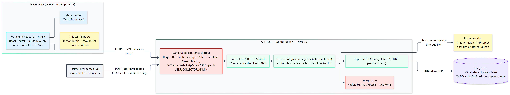
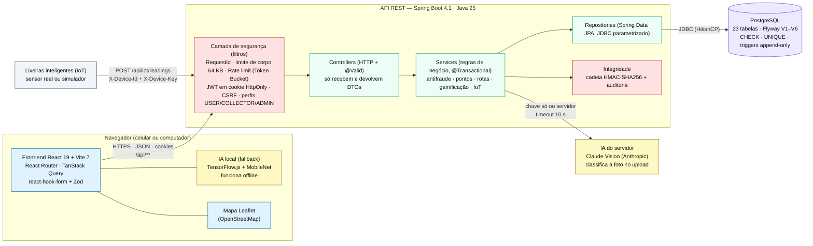

# Arquitetura — Lixo Zero 2050

> ExpoTech 2026.2 · UniFECAF · 4º semestre de Ciência da Computação · categoria **INTELLIGENCE** · tema *Smart Home 2050*
> Complementa a [Modelagem de Dados](MODELAGEM_DE_DADOS.md) e o [Fluxograma](FLUXOGRAMA.md). Detalhes do back-end: [`backend/README.md`](../backend/README.md); contrato da API: [`API.md`](API.md).

## 1. Visão geral

<!-- diagrama: arquitetura -->

- **Monólito em camadas, organizado por funcionalidade**: cada pacote em `backend/src/main/java/br/com/ecotechzero/lixozero/` (ex.: `disposal/`, `route/`, `household/`) tem seu *controller → service → repository*. Entidades nunca saem da API; entram e saem **DTOs** (`*Dtos.java`, `record`s imutáveis).
- **IA híbrida**: com `ANTHROPIC_API_KEY`, a foto é classificada **no servidor** no momento do upload e a classificação é gravada na própria foto (só ela vale para o bônus de +10 %). Sem a chave, ou se o servidor não sugerir nada, o navegador usa o **MobileNet local** (`frontend/src/features/resident/disposal/localClassifier.ts`) — a sugestão aparece, mas é só um palpite (não dá bônus e só pode aumentar o risco antifraude).
- **IoT (Smart Home)**: cada lixeira tem `device_id` + chave secreta (o banco guarda só o hash). O endpoint `/api/iot/readings` é o único POST sem CSRF (é chamado por um dispositivo, não por um navegador). Para a demonstração, `iot/IotSimulator.java` gera leituras a cada 90 s.
- **Banco**: PostgreSQL embarcado em desenvolvimento (`config/EmbeddedPostgresConfig.java`, sem instalar nada) ou externo via `DB_URL`; o esquema é sempre criado pelo Flyway.

## 2. Stack tecnológica

| Camada | Tecnologia | Onde |
|---|---|---|
| Linguagem do back-end | **Java 25** | `backend/pom.xml` |
| Framework (integração front/back) | **Spring Boot 4.1** (Web MVC, Data JPA, Validation, Security, Actuator) | `backend/pom.xml` |
| Banco relacional | **PostgreSQL** + **Flyway** (migrações) + HikariCP; `embedded-postgres` em dev | `backend/src/main/resources/db/migration/` |
| Autenticação | JWT HS256 (`jjwt`) em cookie HttpOnly, refresh token opaco, **Argon2id** (Bouncy Castle) | `security/`, `auth/` |
| IA no servidor | Claude Vision via HTTP (`ai/ClaudeVisionClassifier.java`) | `ai/` |
| Front-end | **React 19**, **Vite 7**, TypeScript 5.9, Tailwind CSS 4 | `frontend/package.json` |
| Dados no front | TanStack Query (cache), React Router 7 (rotas e guardas por perfil) | `frontend/src/api/`, `frontend/src/app/router.tsx` |
| Formulários e validação | react-hook-form + **Zod** (espelha as regras do back-end) | `frontend/src/lib/validation.ts` |
| Mapas e gráficos | Leaflet / react-leaflet (OpenStreetMap), Recharts | `frontend/src/pages/app/MapPage.tsx`, painéis |
| IA local | TensorFlow.js + MobileNet (pesos locais, offline) | `frontend/src/features/resident/disposal/` |
| Testes | JUnit 5 + Spring Boot Test (unitários e integração contra PostgreSQL real embarcado) | `backend/src/test/java/` |

## 3. Requisitos do edital × implementação

Fonte: `referencias/Expotech - 4º semestre (1).pdf` e `referencias/08_INTELLIGENCE_4Sem_CDC (1).pdf`.

| Requisito | Atendido | Como / onde |
|---|---|---|
| **Modelagem de Dados** | ✅ | [`docs/MODELAGEM_DE_DADOS.md`](MODELAGEM_DE_DADOS.md): ER, dicionário, regras, normalização; esquema real em `db/migration/V1..V6` |
| **Fluxograma** | ✅ | [`docs/FLUXOGRAMA.md`](FLUXOGRAMA.md): fluxo geral + 8 fluxos detalhados + sequência + estados |
| **Interface (UX/UI)** | ✅ | Web responsiva (celular e computador): menu por perfil (`frontend/src/app/navigation.ts`), barra inferior no celular, assistente em etapas para o descarte (`frontend/src/features/resident/disposal/Stepper.tsx`), mapa, gráficos, feedback de erro por campo |
| **Validação de Dados** | ✅ | Front: Zod + campos numéricos dedicados (`frontend/src/components/ui/NumberInput.tsx`) que não aceitam texto. Back: Bean Validation nos DTOs (`@NotNull`, `@Size`, `@DecimalMin`...), Jackson estrito (campo desconhecido = 400), regras nos serviços. Banco: `CHECK`/`UNIQUE` |
| **Linguagem de Programação** | ✅ | Java 25 (back-end inteiro) |
| **Integração Front-end/Back-end** | ✅ | Spring Boot (API REST JSON) ↔ React via `fetch` com cookies (`frontend/src/api/client.ts`); em dev o Vite encaminha `/api` para `localhost:8080` |
| **Autenticação de Usuário** | ✅ | Login e senha (Argon2id), JWT de 15 min + refresh com rotação, CSRF, bloqueio após 5 erros (`auth/AuthService.java`) |
| **Banco de Dados Relacional** | ✅ | PostgreSQL com 23 tabelas, FKs, constraints e triggers |
| **Perfis de Usuário** (mín. 2) | ✅ | 3 perfis: **Morador** (`USER`, acesso limitado), **Coletor** (`COLLECTOR`) e **Administrador** (`ADMIN`, controla tudo). Regras em `security/SecurityConfig.java` + checagem de dono nos serviços (anti-IDOR) |
| Tema **Smart Home 2050** | ✅ | Residência com moradores (código de convite), dispositivos conectados (lixeiras com cadastro, status online/offline, bateria e histórico de leituras) e rotina automática (pedido de coleta ao atingir o limite) — `household/`, `iot/` |

> Observação para a banca: no edital, o "Administrador" é descrito como quem "mora na casa e controla tudo". No Lixo Zero 2050, a casa é compartilhada por moradores e o **Administrador** é o gestor da plataforma (moderação, coletas, catálogo, usuários). O dono da residência (`households.owner_id`) é quem a criou.

## 4. Conceitos avaliados × código

### 4.1 Programação Orientada a Objetos

| Conceito | Exemplo concreto | Arquivo |
|---|---|---|
| **Interface + polimorfismo (padrão Strategy)** | `FraudRule` tem 8 implementações; o `FraudEngine` recebe `List<FraudRule>` por injeção e chama `rule.evaluate(ctx)` sem conhecer nenhuma classe concreta. Nova regra = nova classe | `fraud/FraudRule.java`, `fraud/FraudEngine.java`, `fraud/rules/*.java` |
| **Polimorfismo com troca de implementação** | `WasteClassifier` → `ClaudeVisionClassifier` (IA na nuvem) ou `UnavailableClassifier` (sem chave); `AiConfig` escolhe na inicialização e o `PhotoService` não muda | `ai/WasteClassifier.java`, `ai/AiConfig.java` |
| **Interface + `record`s** | `BadgeRule` → `ThresholdBadge`, `CategoryKgBadge`, `AllRecyclablesBadge` | `gamification/badge/BadgeRule.java`, `gamification/badge/BadgeCatalog.java` |
| **Herança (classe abstrata)** | `BaseEntity` (abstrata, `@MappedSuperclass`) dá `id`, `createdAt`, `updatedAt`, `equals/hashCode` a todas as entidades (`User extends BaseEntity`, `Disposal extends BaseEntity`...) | `common/BaseEntity.java` |
| **Herança de framework** | Filtros de segurança estendem `OncePerRequestFilter` | `security/JwtAuthenticationFilter.java`, `security/ApiRateLimitFilter.java` |
| **Encapsulamento** | Estado crítico sem *setter* público: só muda por métodos com regra — `Disposal.approve/reject` (só se `PENDING`), `User.earn/spend`, `Reward.decrementStock`, `CollectionRoute.removeStop` (renumera e recalcula), `User.registerSecurityWarning` | `disposal/Disposal.java`, `user/User.java`, `route/CollectionRoute.java` |
| **Imutabilidade** | DTOs e resultados como `record` (`DisposalDtos`, `RouteOptimizer.Plan`, `FraudSignal`); `point_transactions` e `audit_log` como entidades `@Immutable` | `disposal/DisposalDtos.java`, `points/PointTransaction.java` |
| **Enum com comportamento** | `AiSource.isServerSide()`, `CollectionRequestStatus.OPEN` | `ai/AiSource.java`, `collection/CollectionRequestStatus.java` |
| **Injeção de dependência** | Todos os serviços recebem dependências pelo construtor (fácil testar e trocar) | ex.: `disposal/DisposalService.java` |

### 4.2 Estruturas de Dados e Algoritmos

| Estrutura / algoritmo | Uso | Arquivo |
|---|---|---|
| **`PriorityQueue` (min-heap)** | Vizinho mais próximo: entrega a parada mais próxima que ainda cabe no caminhão | `route/RouteOptimizer.nearestNeighbour` |
| **Matriz `double[][]`** | Distâncias Haversine pré-calculadas entre garagem e paradas (consulta O(1)) | `route/RouteOptimizer.distanceMatrix`, `common/GeoPoint.java` |
| **Arrays e listas no 2-opt** | Rota como `int[]` com a garagem nas pontas; inversão de trechos *in place* | `route/RouteOptimizer.twoOpt` |
| **`boolean[]` de visitados** | Controle das paradas já atendidas | `route/RouteOptimizer.nearestNeighbour` |
| **`ConcurrentHashMap` + Token Bucket** | Limite de requisições por IP/e-mail/usuário/dispositivo, com teto de memória | `common/TokenBucketRateLimiter.java` |
| **`ConcurrentHashMap`** | Contador de tentativas de login por e-mail (com despejo de entradas velhas) | `auth/LoginAttemptService.java` |
| **`HashMap`/`Map`** | Densidade kg/L por material; índice id → solicitação ao montar rotas | `household/SmartBinService.java`, `route/RouteService.java` |
| **`HashSet`/`EnumSet`** | Medalhas já obtidas, desafios concluídos, status "abertos" | `gamification/GamificationService.java`, `collection/CollectionRequestStatus.java` |
| **dHash (hash perceptual 64 bits) + distância de Hamming** | Fotos parecidas: `Long.bitCount(a ^ b)` | `photo/PerceptualHash.java` |
| **SHA-256 e HMAC-SHA256** | Foto idêntica, tokens e chaves guardados só como hash; cadeia de integridade | `photo/`, `auth/RefreshTokenService.java`, `integrity/` |
| **Lista encadeada por hash (cadeia)** | Cada lançamento aponta para o hash do anterior | `integrity/LedgerChain.java`, `integrity/AuditChain.java` |
| **Pontuação de prioridade e sequência de dias** | Prioridade de coleta 0–100; *streak* de dias seguidos | `collection/PriorityCalculator.java`, `gamification/StreakCalculator.java` |

### 4.3 Engenharia de Software

| Prática | Evidência |
|---|---|
| **Arquitetura em camadas** | Controller → Service → Repository em cada pacote; DTOs separados das entidades (`backend/README.md`, seção Arquitetura) |
| **Migrações versionadas** | Flyway `V1`…`V6` (incluindo uma migração em Java, `integrity/IntegrityBackfillMigration.java`); `ddl-auto: none` |
| **Testes automatizados** | Unitários: `DomainRulesTest`, `fraud/FraudRulesTest`, `route/RouteOptimizerTest`, `photo/ImageProcessorTest`, `security/SecurityHardeningTest`, `common/RobustnessTest`, `route/RouteCancellationTest`. Integração (PostgreSQL real): `ApiIntegrationTest`, `SecurityHardeningIntegrationTest` — em `backend/src/test/java/br/com/ecotechzero/lixozero/` |
| **Tratamento de erros padronizado** | RFC 7807 (`common/GlobalExceptionHandler.java`, `common/ErrorCode.java`), código de rastreio `X-Request-Id` |
| **Configuração externa** | Variáveis de ambiente / `.env` (`application.yml`, `config/AppProperties.java`); nenhum segredo no Git |
| **Segurança por design** | Defesa em camadas (front → API → banco), auditoria, integridade; tabela completa em `backend/README.md` |
| **Contrato de API documentado** | `docs/API.md` + tipos do front em `frontend/src/api/types.ts` |
| **Diagramas reprodutíveis** | `docs/diagramas/gerar-diagramas.mjs` gera SVG/PNG a partir do Mermaid dos documentos |
