# Fluxograma da Aplicação — Lixo Zero 2050

> ExpoTech 2026.2 · UniFECAF · 4º semestre de Ciência da Computação · categoria **INTELLIGENCE** · tema *Smart Home 2050*
>
> Entregável obrigatório **"Fluxograma"**: o fluxo completo da aplicação, do visitante às áreas de cada perfil, e os fluxos
> internos mais importantes. Cada passo corresponde a código real (os arquivos citados estão em
> `backend/src/main/java/br/com/ecotechzero/lixozero/` e `frontend/src/`).
>
> Imagens prontas para slides e impressão em `docs/diagramas/` (PNG em alta resolução, fundo branco; SVG vetorial para ampliar sem perder qualidade). Para regenerar depois de editar um diagrama: `node docs/diagramas/gerar-diagramas.mjs`.

**Sumário**

0. [Legenda (símbolos)](#0-legenda-símbolos)
1. [Fluxo geral da aplicação](#1-fluxo-geral-da-aplicação)
2. [Autenticação: login, CSRF, JWT, refresh e bloqueio](#2-autenticação)
3. [Registro de descarte com IA e antifraude](#3-registro-de-descarte)
4. [Moderação pelo administrador](#4-moderação-pelo-administrador)
5. [Resgate de recompensa](#5-resgate-de-recompensa)
6. [Smart Home: leitura IoT e pedido automático de coleta](#6-smart-home-leitura-iot-e-pedido-automático-de-coleta)
7. [Coleta e rota otimizada](#7-coleta-e-rota-otimizada)
8. [Bloqueio por inspeção](#8-bloqueio-por-inspeção)
9. [Verificação de integridade (cadeia HMAC)](#9-verificação-de-integridade-cadeia-hmac)
10. [Diagramas de sequência](#10-diagramas-de-sequência)
11. [Ciclos de vida (estados)](#11-ciclos-de-vida-estados)

---

## 0. Legenda (símbolos)

Todos os fluxogramas usam a simbologia padrão (ISO 5807 / ANSI) e as mesmas cores:

| Forma | Significado | Cor |
|---|---|---|
| Retângulo de cantos arredondados (*terminal*) | Início / Fim | verde-escuro |
| Retângulo | Processo executado pelo sistema | verde-claro |
| Losango | Decisão (sim / não) | amarelo |
| Paralelogramo | Entrada ou saída de dados (formulário, tela, requisição) | azul |
| Cilindro | Banco de dados | lilás |
| Retângulo com barras laterais | Subprocesso detalhado em outro diagrama | cinza |
| Retângulo vermelho | Erro / resposta negativa (código HTTP) | vermelho |

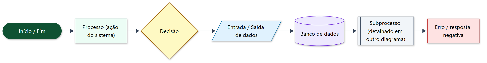

<!-- diagrama: legenda -->
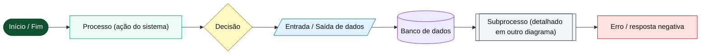

Nomes usados de forma consistente: **Morador** (perfil `USER`), **Coletor** (`COLLECTOR`), **Administrador** (`ADMIN`);
**API** = back-end Spring Boot; **Front** = aplicação React no navegador; **BD** = PostgreSQL.

---

## 1. Fluxo geral da aplicação

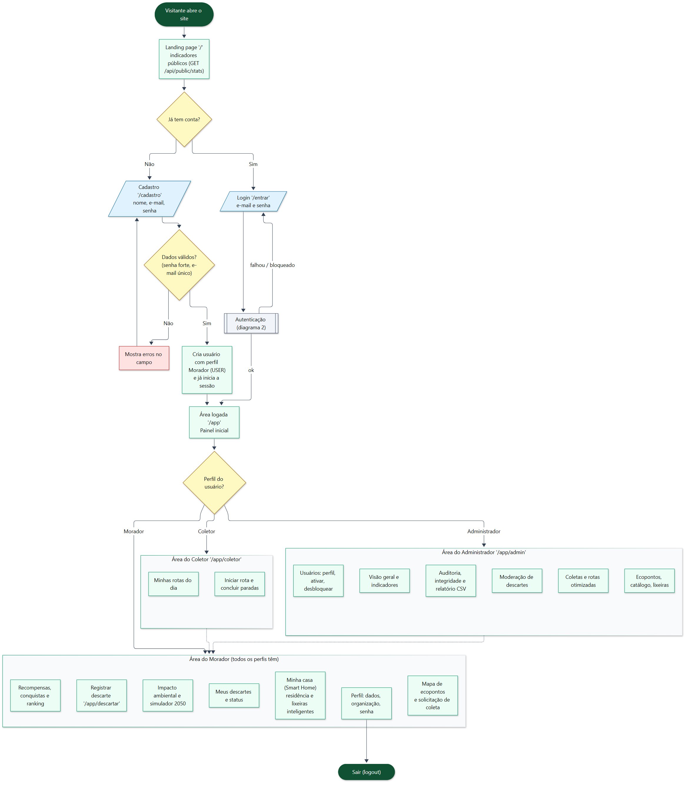

<!-- diagrama: fluxo-geral -->
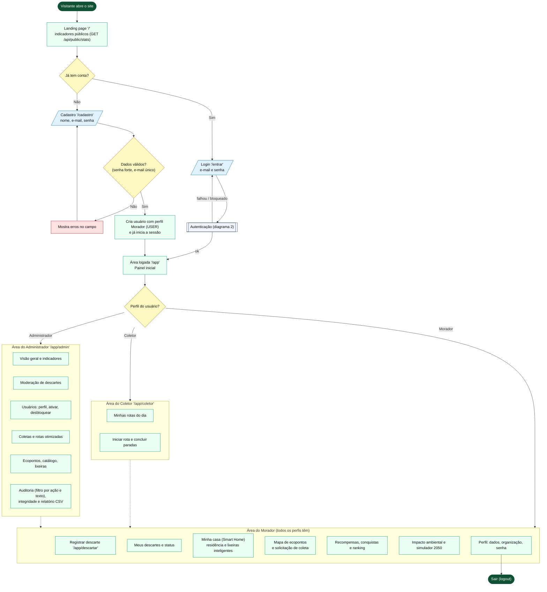

**Como explicar:**
- O cadastro público cria sempre um **Morador**. Só o Administrador muda o perfil de alguém para Coletor ou Administrador (`PATCH /api/admin/users/{id}`). Isso evita que alguém "se promova" mandando `"role":"ADMIN"` no cadastro.
- A navegação é filtrada por perfil no Front (`frontend/src/app/navigation.ts`, `RequireRole` em `frontend/src/app/router.tsx`), **mas quem garante a permissão é a API**: `/api/admin/**` só aceita `ADMIN` e `/api/collector/**` aceita `COLLECTOR` ou `ADMIN` (`security/ConfigSeguranca.java`).
- Coletor e Administrador também têm acesso às telas do Morador (linhas tracejadas).

---

## 2. Autenticação

### 2.1 Login (com CSRF, JWT em cookie e bloqueio por tentativas)

Código: `auth/ServicoAutenticacao.entrar`, `auth/ServicoTentativasLogin.java`, `security/ServicoJwt.java`, `security/CookiesAutenticacao.java`, `frontend/src/api/client.ts`.

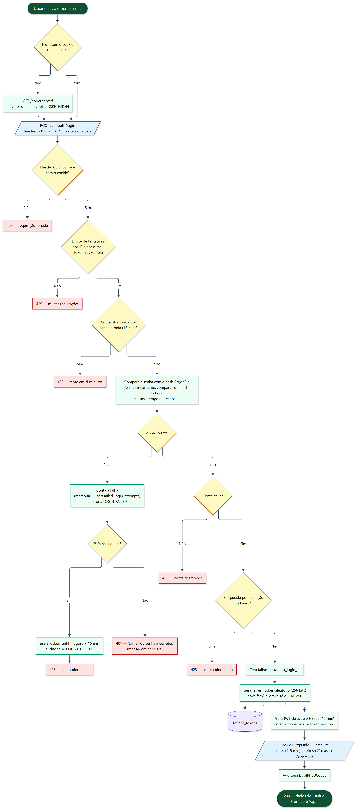

<!-- diagrama: fluxo-login -->
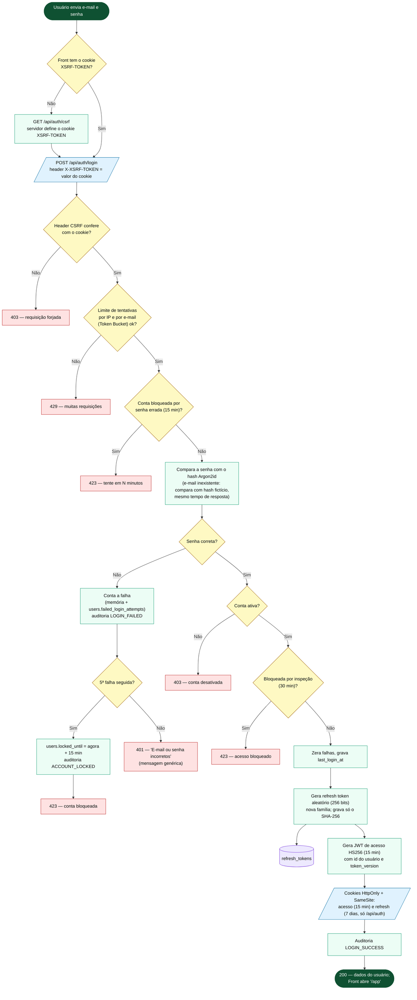

### 2.2 Cada requisição autenticada e a renovação da sessão (refresh com rotação e detecção de reuso)

Código: `security/FiltroAutenticacaoJwt.java`, `auth/ServicoTokensRenovacao.rotacionar`, `frontend/src/api/client.ts` (*single-flight*: uma única renovação compartilhada entre as chamadas).

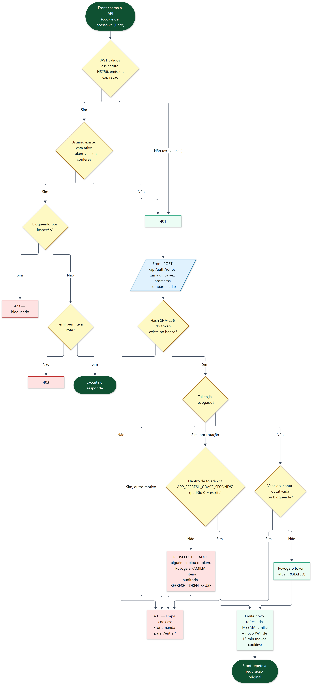

<!-- diagrama: fluxo-refresh -->
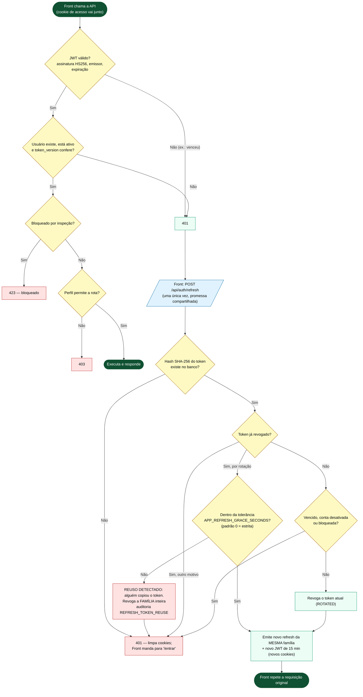

**Por que assim:** o JWT fica em cookie **HttpOnly** (JavaScript não lê, então um XSS não rouba a sessão). O JWT dura só 15 min; o refresh dura 7 dias mas é **trocado a cada uso**. Se um token antigo reaparecer, só pode ser cópia: o sistema derruba todas as sessões daquela família. Trocar a senha, ser desativado ou bloqueado revoga todas as sessões.

---

## 3. Registro de descarte

Código: `frontend/src/pages/app/NewDisposalPage.tsx`, `photo/ServicoFotos.java`, `photo/ProcessadorImagem.java`, `ai/ClassificadorVisaoClaude.java`, `frontend/src/features/resident/disposal/localClassifier.ts`, `disposal/ServicoDescartes.criar`, `fraud/MotorFraude.java`.

**3.1 Foto e sugestão da IA**

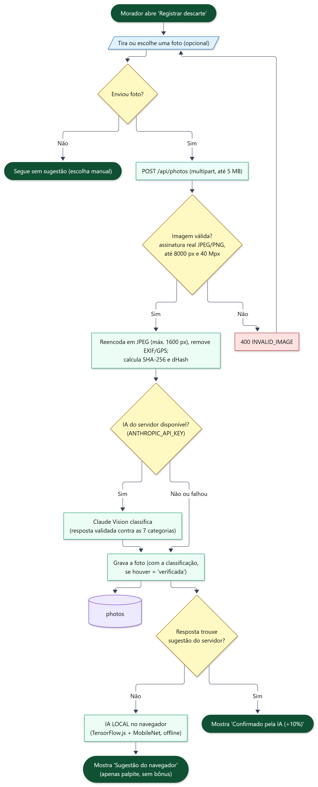

<!-- diagrama: fluxo-descarte-foto -->
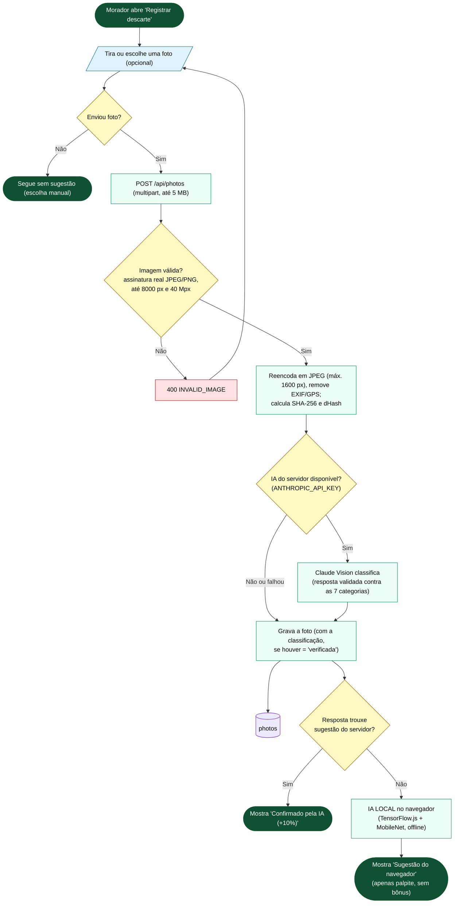

**3.2 Envio, validação e antifraude**

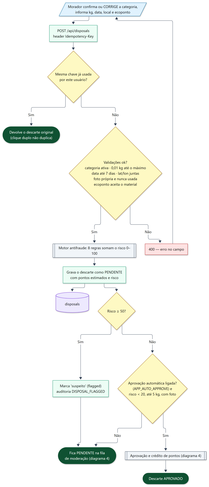

<!-- diagrama: fluxo-descarte-envio -->
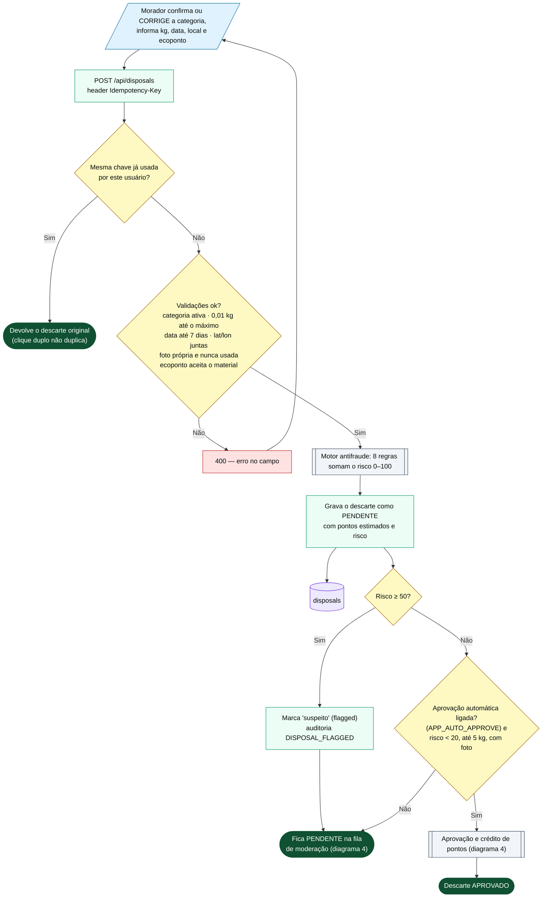

**Regras do motor antifraude** (`fraud/rules/`, cada uma é uma classe que implementa `RegraFraude`):

| Regra (código) | Dispara quando | Risco |
|---|---|---|
| `FOTO_REPETIDA` (`RegraFotoReutilizada`) | Mesma foto (SHA-256) já enviada | +60 |
| `FOTO_SEMELHANTE` (`RegraFotoSemelhante`) | Foto parecida (dHash) nos últimos 180 dias | +30 (própria) / +40 (de outra pessoa) |
| `LIMITE_DIARIO` (`RegraLimiteDiario`) | Mais de 50 kg no dia | +35 |
| `CATEGORIA_DIVERGENTE_IA` (`RegraDivergenciaIa`) | IA (confiança ≥ 0,7) discorda da categoria escolhida | +30 (servidor) / +15 (navegador) |
| `DESLOCAMENTO_IMPOSSIVEL` (`RegraSaltoLocalizacao`) | Saltos ≥ 10 km a mais de 120 km/h | +30 |
| `MUITOS_REGISTROS` (`RegraVelocidade`) | Mais de 4 registros em 10 min | +30 |
| `QUANTIDADE_ATIPICA` (`RegraQuantidadeAtipica`) | Quantidade ≥ 80 % do máximo da categoria | +20 |
| `SEM_FOTO` (`RegraFotoAusente`) | Acima de 5 kg sem foto | +15 |

A soma é limitada a 100. O palpite da IA do navegador **só pode aumentar** o risco, nunca reduzir nem dar bônus.

---

## 4. Moderação pelo administrador

Código: `disposal/ServicoRevisaoDescartes.java`, `points/ServicoPontos.creditar`, `integrity/CadeiaExtrato.java`, `gamification/ServicoGamificacao.java`.

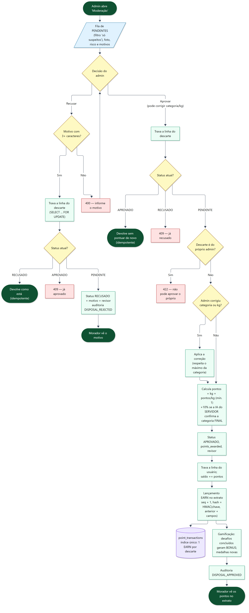

<!-- diagrama: fluxo-moderacao -->
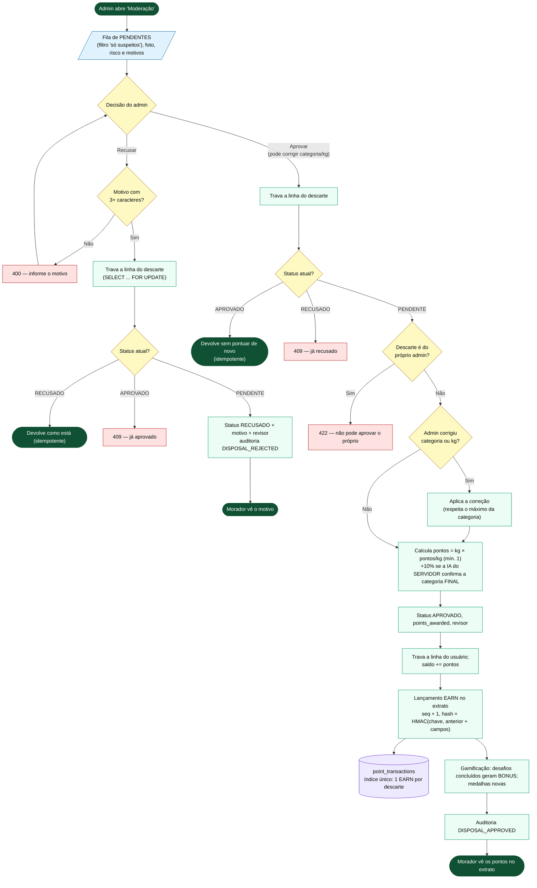

**As duas regras de negócio do edital aparecem aqui:** "apenas descartes aprovados geram pontos" (crédito só neste fluxo + `CHECK ck_disposals_points` no banco) e "cada descarte gera pontos uma única vez" (lock + idempotência + índice único `ux_point_tx_disposal`).

---

## 5. Resgate de recompensa

Código: `reward/ServicoRecompensas.resgatar`, `points/ServicoPontos.debitar`.

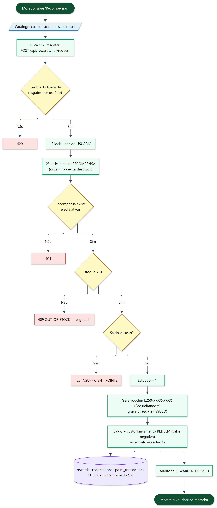

<!-- diagrama: fluxo-resgate -->
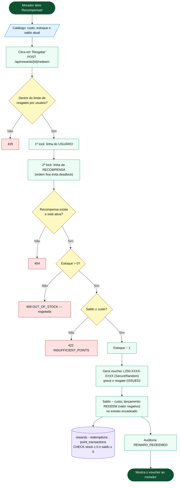

Tudo acontece numa **única transação**: se qualquer passo falhar, nada é gravado (nem estoque, nem voucher, nem débito). Os códigos HTTP exatos dos erros de negócio estão em `common/CodigoErro.java`.

---

## 6. Smart Home: leitura IoT e pedido automático de coleta

Código: `household/ServicoResidencia.java`, `household/ServicoLixeiras.java`, `iot/ControladorIot.java`, `iot/SimuladorIot.java`.

**6.1 Configuração (uma vez, pelo morador)**

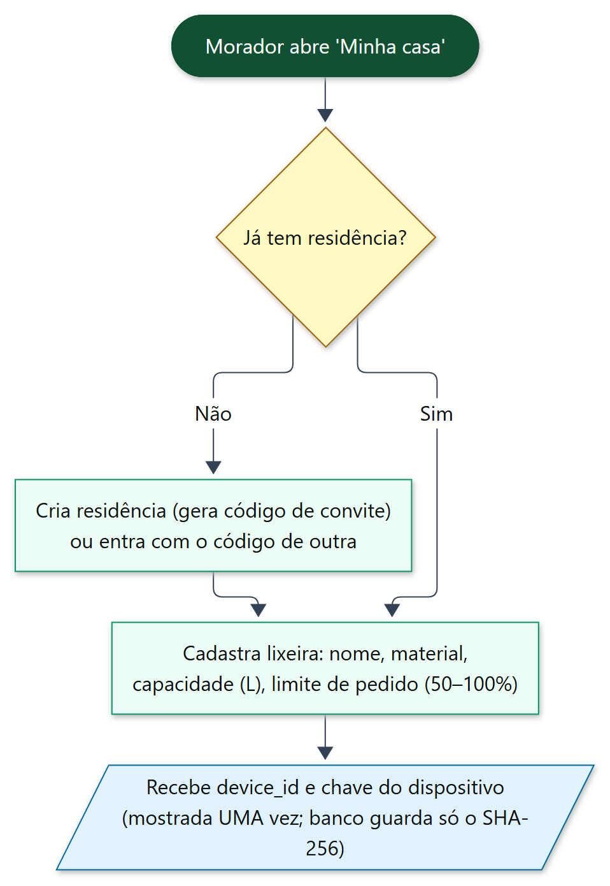

<!-- diagrama: fluxo-smarthome-config -->
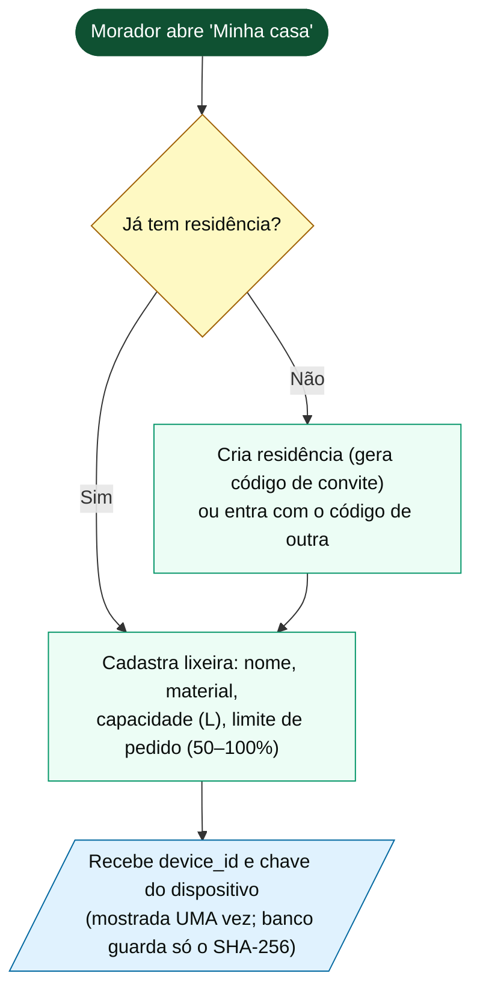

**6.2 Cada leitura do sensor**

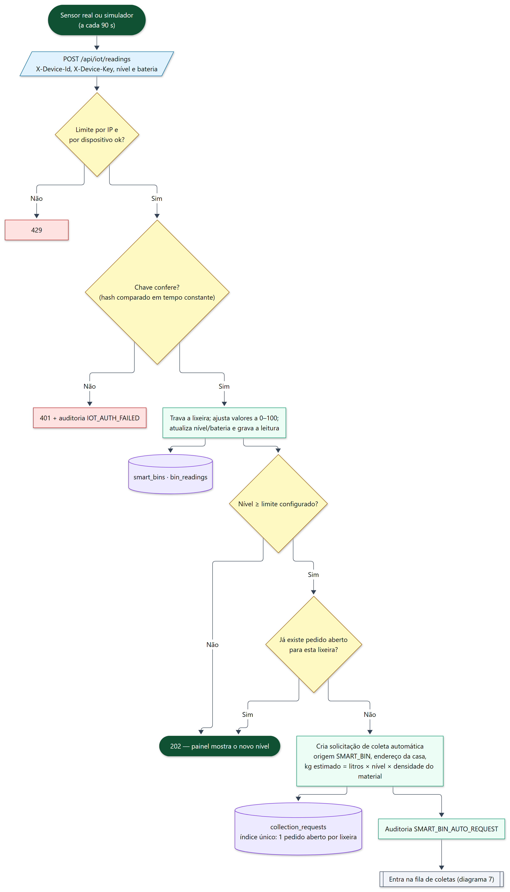

<!-- diagrama: fluxo-smarthome-leitura -->
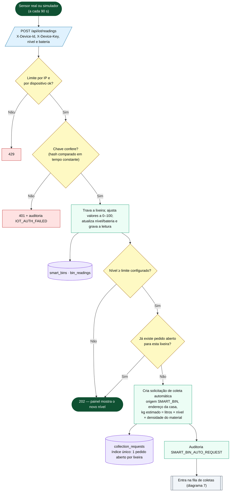

Os dois blocos se ligam quando o morador grava o `device_id` e a chave no dispositivo (ou quando a lixeira é simulada). Sem leitura há mais de 6 h, a lixeira aparece como **offline** (`APP_IOT_OFFLINE_HOURS`). Depois que o coletor conclui a parada, a lixeira volta a **0 %** (`ServicoLixeiras.esvaziarAposColeta`).

---

## 7. Coleta e rota otimizada

Código: `collection/ServicoSolicitacoesColeta.java`, `collection/CalculadoraPrioridade.java`, `route/ServicoRotas.java`, `route/OtimizadorRotas.java`, `route/ControladorColetor.java`.

**7.1 Planejamento pelo administrador (otimização)**

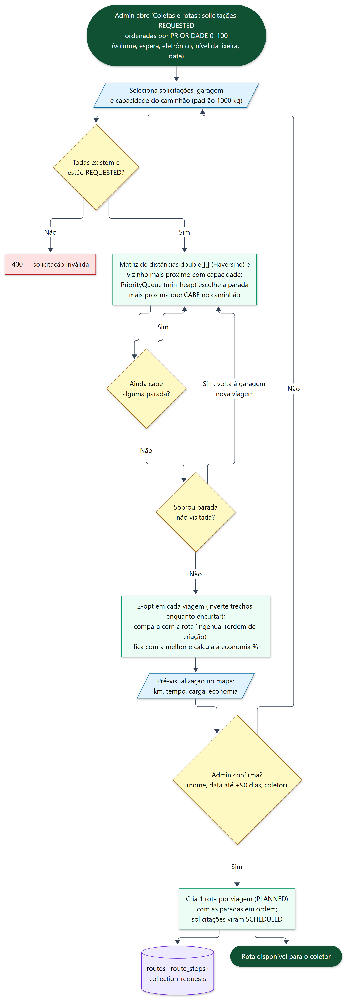

<!-- diagrama: fluxo-rota-planejamento -->
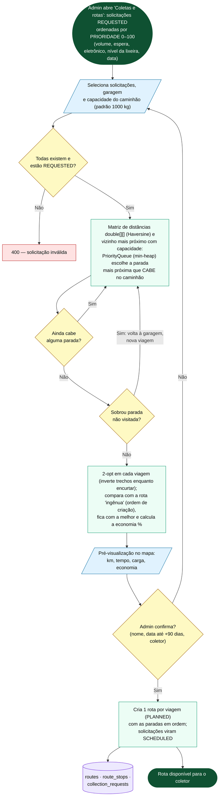

**7.2 Execução pelo coletor**

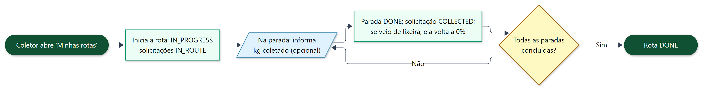

<!-- diagrama: fluxo-rota-execucao -->
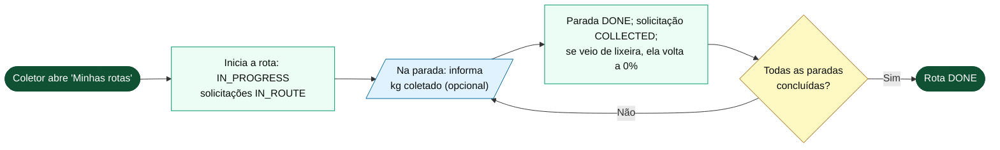

**Cancelamento:** o morador (ou admin) pode cancelar uma solicitação enquanto ela está `REQUESTED` ou `SCHEDULED` em rota ainda `PLANNED`; a parada sai da rota, as demais são renumeradas e distância, tempo e carga são recalculados (`CollectionRoute.removeStop`).
**Por que heurística:** o roteamento com capacidade (CVRP) é NP-difícil; vizinho mais próximo (O(n² log n)) + 2-opt dão uma boa rota em milissegundos.

---

## 8. Bloqueio por inspeção

Código: `frontend/src/security/InspectionGuard.tsx`, `frontend/src/security/shortcuts.ts`, `frontend/src/security/devtoolsDetector.ts`, `security/ServicoInspecao.java`, `admin/ServicoAdmin.desbloquearUsuario`.

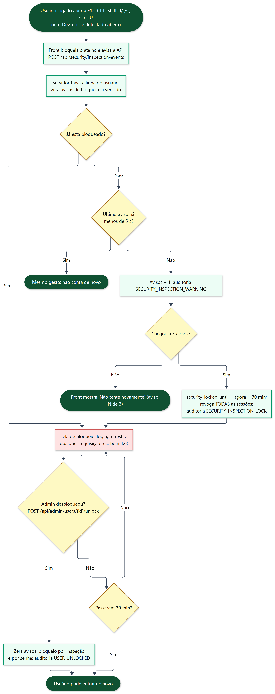

<!-- diagrama: fluxo-inspecao -->
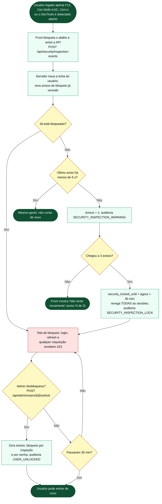

O menu de contexto (botão direito) é desativado na área logada, mas **não conta aviso**. **Limite honesto:** bloquear o inspetor é só dissuasão; a proteção real está no servidor (autorização, validação, antifraude, integridade). O navegador apenas avisa; quem conta e bloqueia é a API.

---

## 9. Verificação de integridade (cadeia HMAC)

Código: `integrity/CadeiaExtrato.java`, `integrity/CadeiaAuditoria.java`, `integrity/HashesCadeia.java`, `integrity/ServicoIntegridade.java`, `integrity/ControladorIntegridade.java`.

**9.1 Ao gravar um lançamento (extrato ou auditoria)**

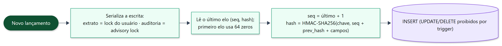

<!-- diagrama: fluxo-integridade-gravacao -->
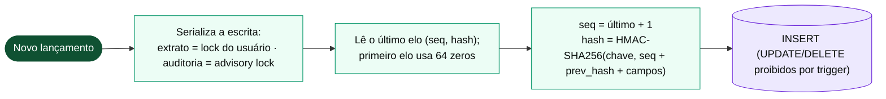

**9.2 Verificação pelo admin: GET /api/admin/integrity**

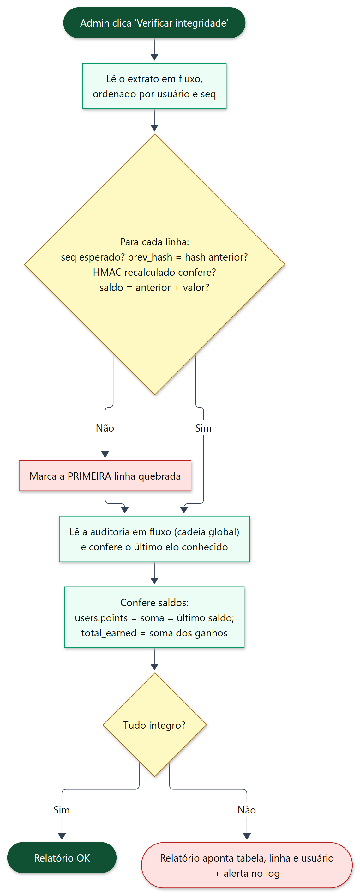

<!-- diagrama: fluxo-integridade-verificacao -->
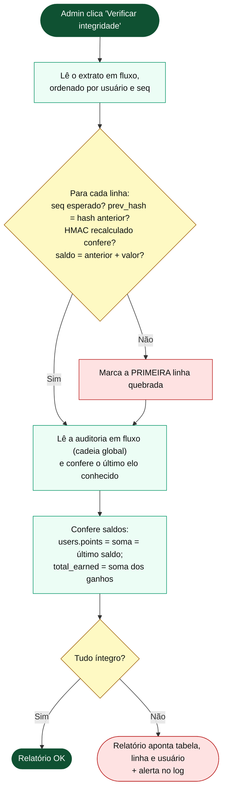

A chave HMAC fica **fora do banco** (`APP_INTEGRITY_KEY` ou `data/integrity.key`): quem só tem acesso ao banco não consegue recalcular os hashes depois de alterar um valor.

---

## 10. Diagramas de sequência

### 10.1 Login e renovação da sessão

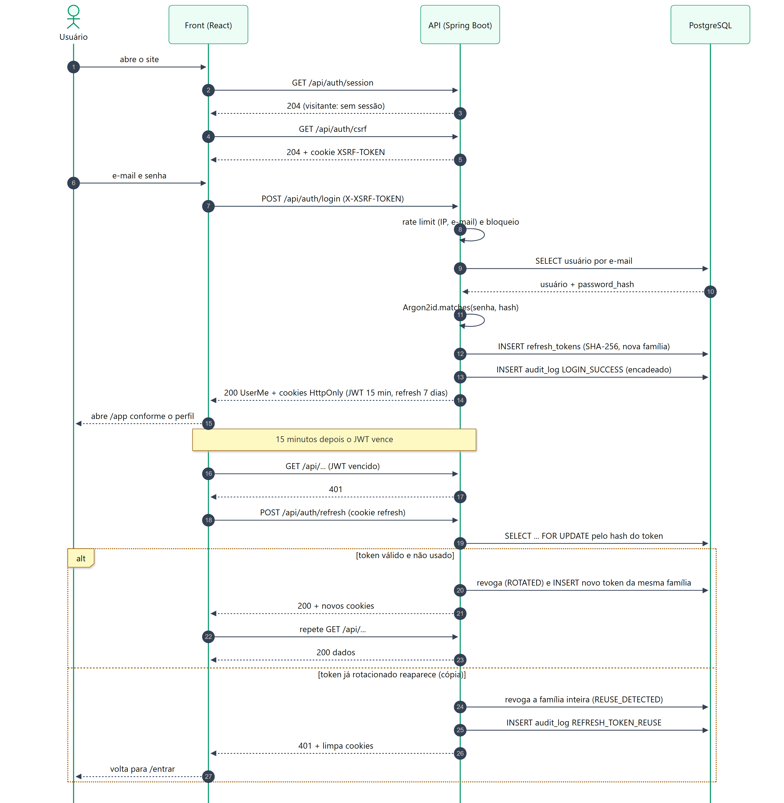

<!-- diagrama: seq-login-refresh -->
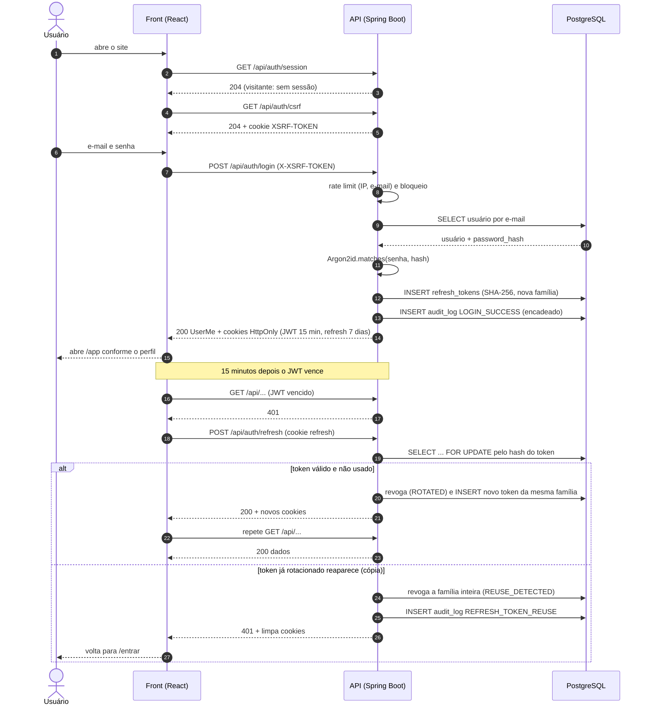

### 10.2 Envio de um descarte

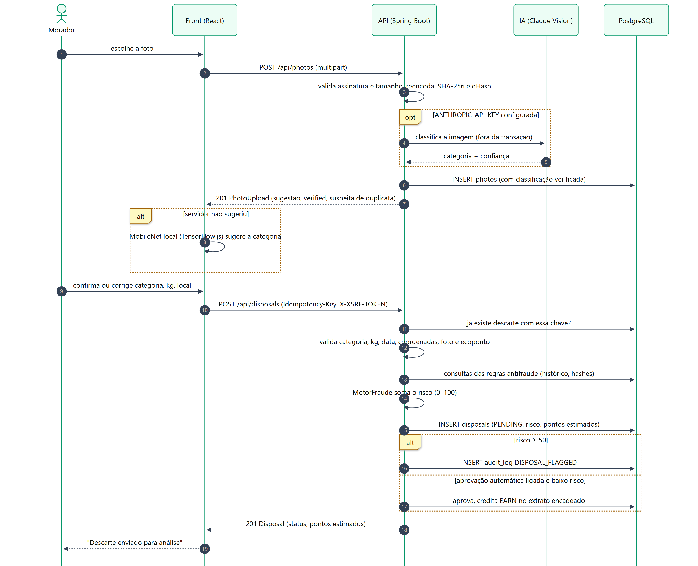

<!-- diagrama: seq-descarte -->
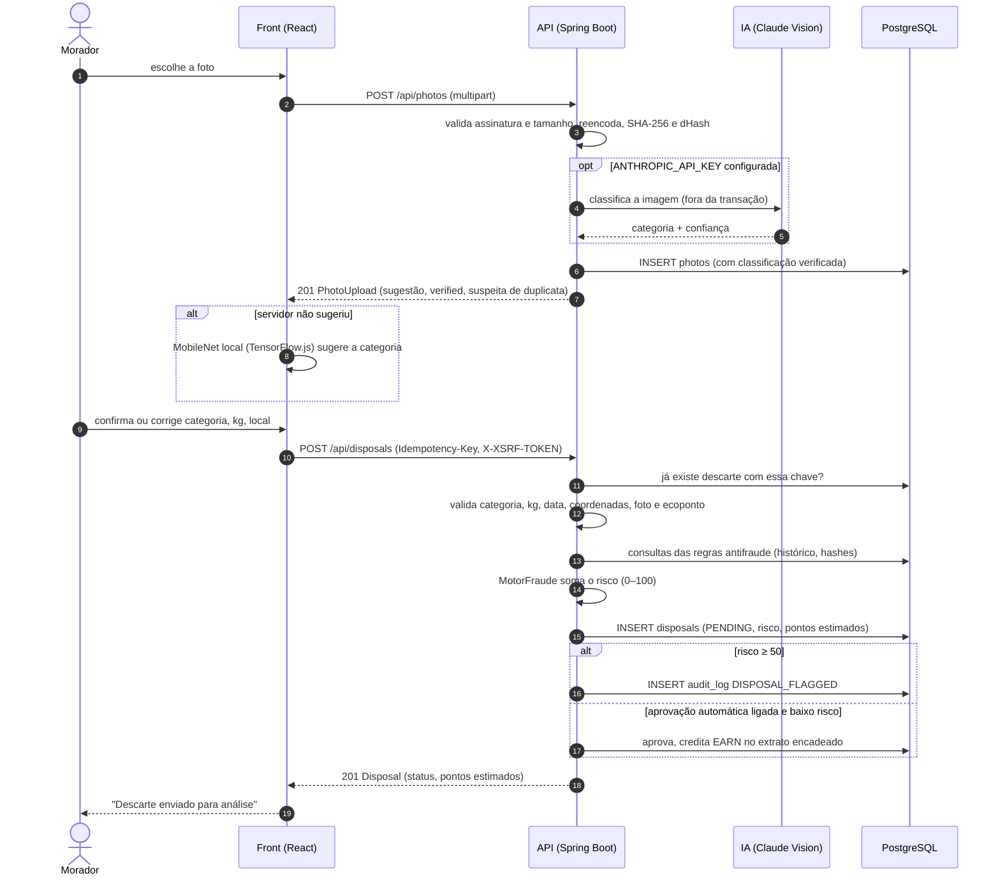

---

## 11. Ciclos de vida (estados)

**Descarte**

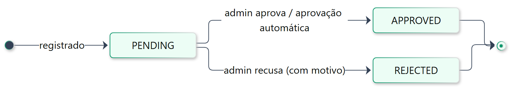

<!-- diagrama: estados-descarte -->
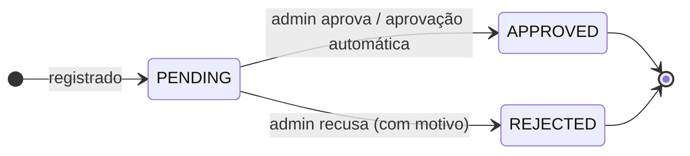

**Solicitação de coleta**

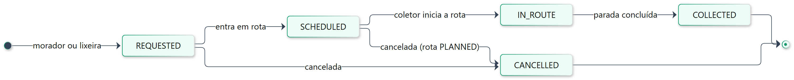

<!-- diagrama: estados-coleta -->
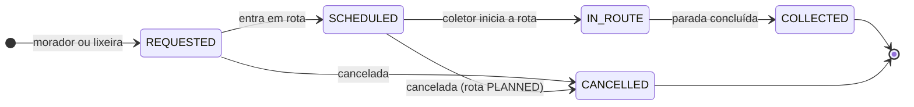

**Rota**

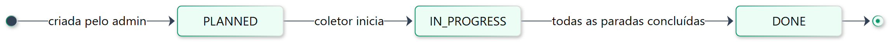

<!-- diagrama: estados-rota -->
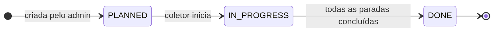
