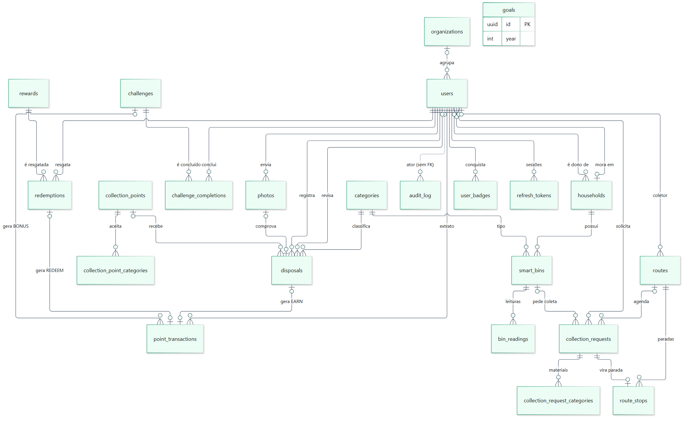
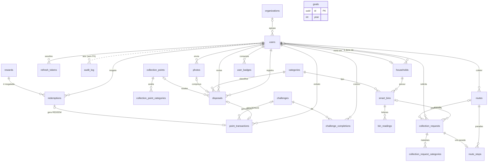
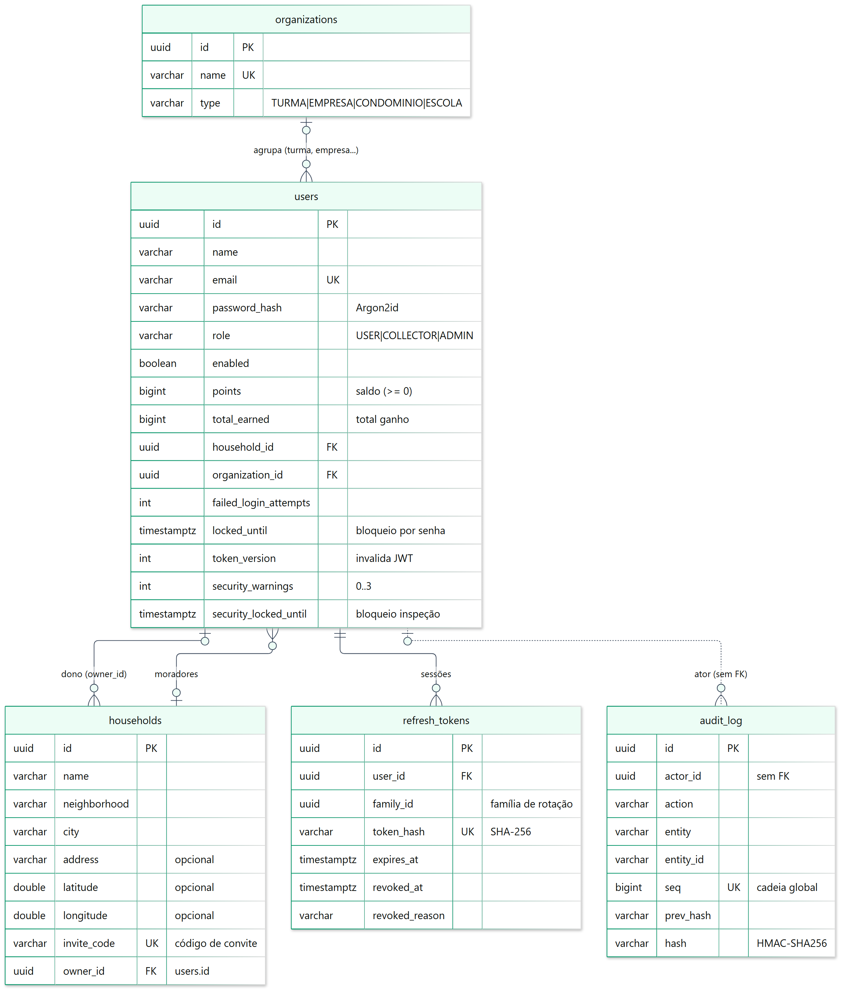
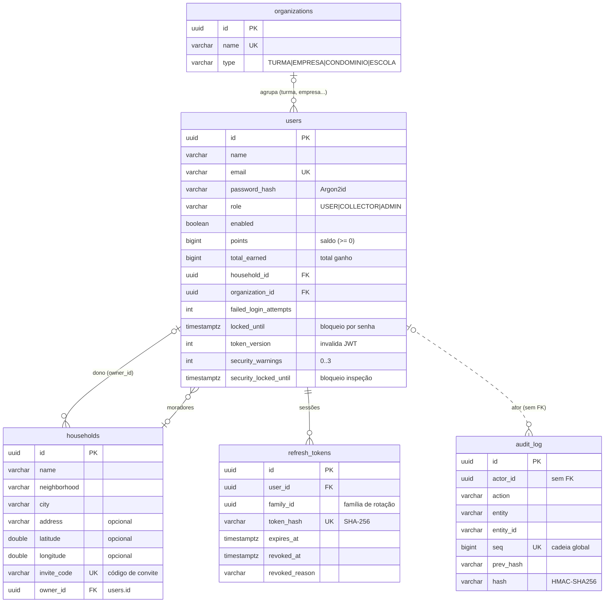
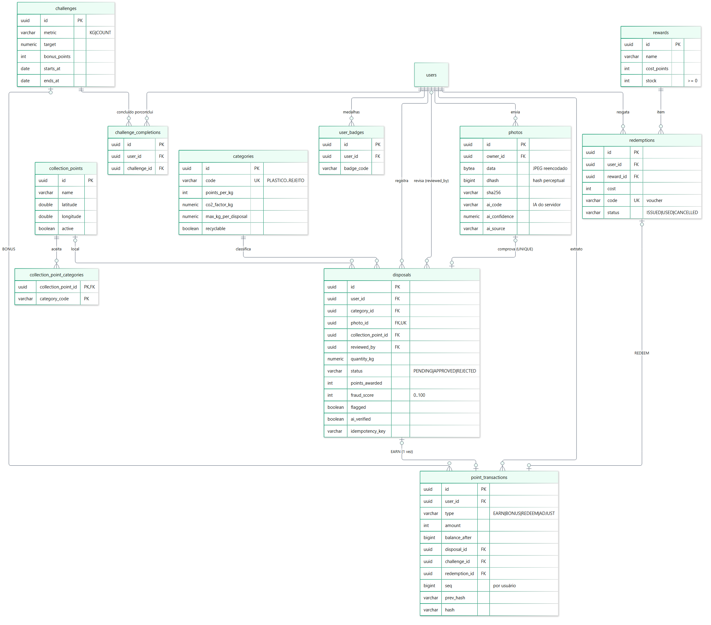
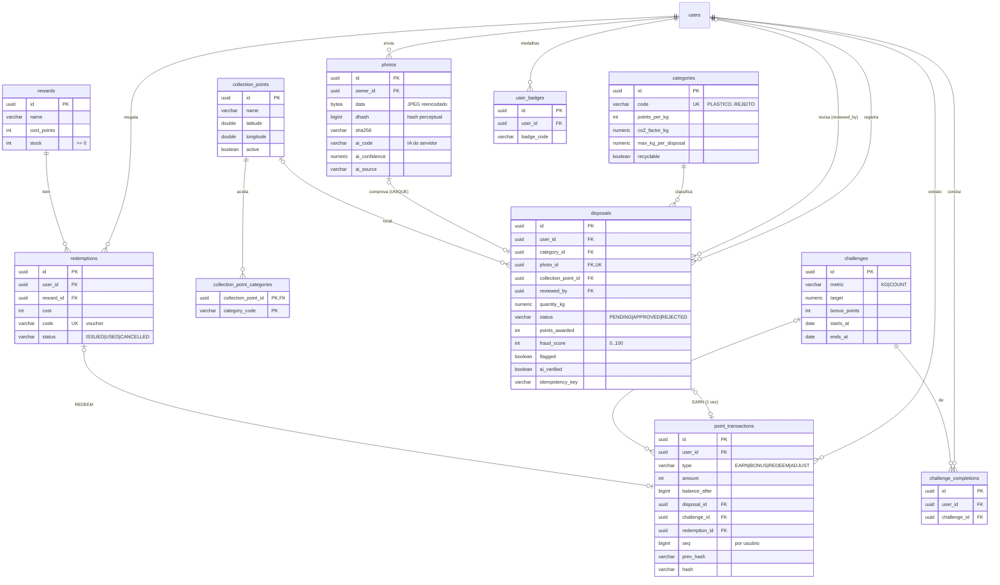
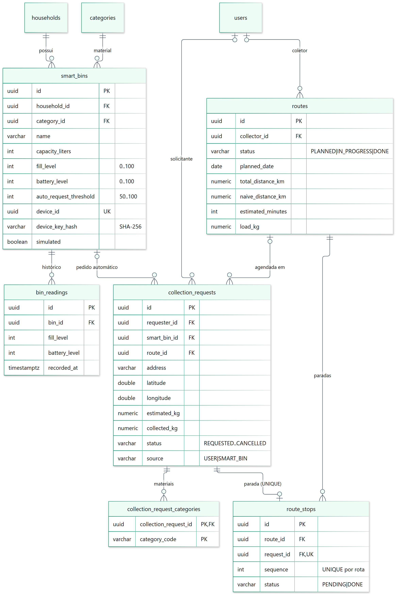
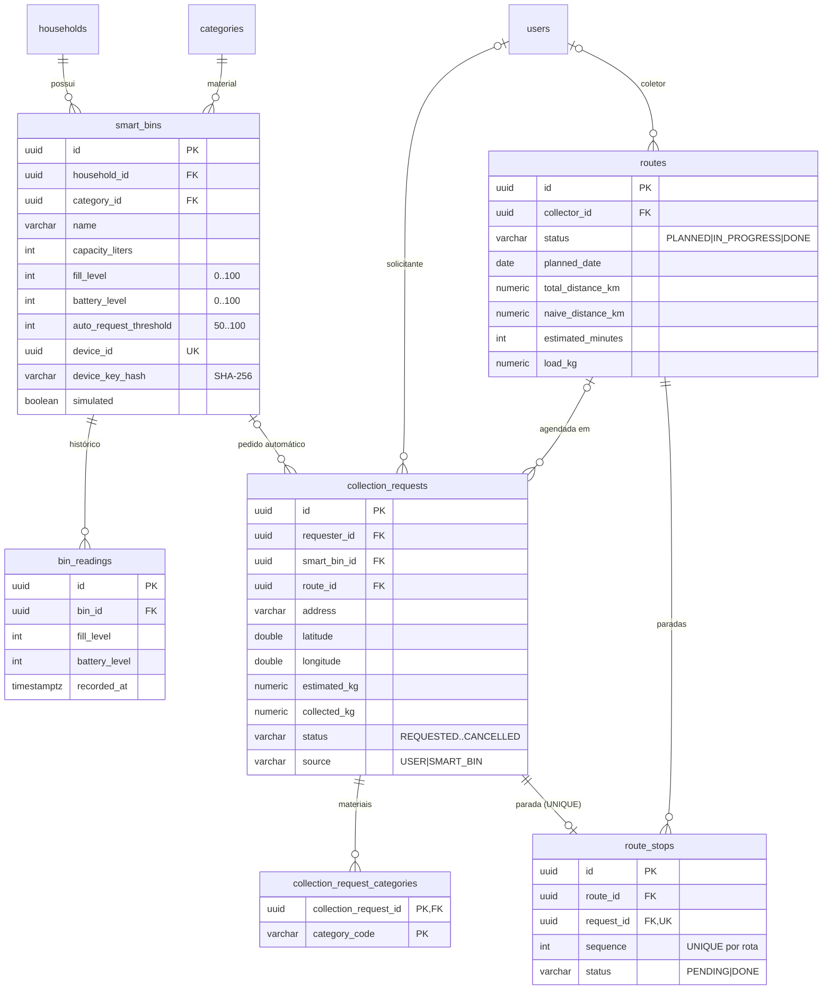

# Modelagem de Dados — Lixo Zero 2050

> ExpoTech 2026.2 · UniFECAF · 4º semestre de Ciência da Computação · categoria **INTELLIGENCE** · tema *Smart Home 2050*
>
> Entregável obrigatório **"Modelagem de Dados"**: estrutura do banco (tabelas, relacionamentos e regras de negócio).
> Tudo o que está aqui existe no código. Fontes da verdade:
> `backend/src/main/resources/db/migration/V1..V6` (Flyway) e as entidades JPA em `backend/src/main/java/br/com/ecotechzero/lixozero/`.

**Sumário**

1. [Visão geral e decisões de projeto](#1-visão-geral-e-decisões-de-projeto)
2. [Diagramas Entidade-Relacionamento](#2-diagramas-entidade-relacionamento)
3. [Dicionário de dados](#3-dicionário-de-dados)
4. [Regras de negócio e onde são garantidas](#4-regras-de-negócio-e-onde-são-garantidas)
5. [Normalização (até a 3FN)](#5-normalização-até-a-3fn)
6. [Histórico das migrações](#6-histórico-das-migrações)
7. [Roteiro rápido para explicar aos professores](#7-roteiro-rápido-para-explicar-aos-professores)

---

## 1. Visão geral e decisões de projeto

O banco é **relacional (PostgreSQL)** e tem **23 tabelas** organizadas em três domínios:

| Domínio | Tabelas |
|---|---|
| **Usuários, Residência e Segurança** | `users`, `organizations`, `households`, `refresh_tokens`, `audit_log` |
| **Descartes, Pontos e Gamificação** | `categories`, `photos`, `disposals`, `collection_points`, `collection_point_categories`, `point_transactions`, `rewards`, `redemptions`, `challenges`, `challenge_completions`, `user_badges`, `goals` |
| **Coletas, Rotas e IoT (Smart Home)** | `smart_bins`, `bin_readings`, `collection_requests`, `collection_request_categories`, `routes`, `route_stops` |

> Contagem: 5 + 12 + 6 = **23 tabelas** — 21 entidades + 2 tabelas de associação N:N (`collection_point_categories`, `collection_request_categories`). A tabela `flyway_schema_history` é do próprio Flyway e não entra na modelagem.

### Decisões e por quê

| Decisão | Como foi feito | Por quê |
|---|---|---|
| **Chave primária UUID** em todas as tabelas | `id uuid primary key`; gerada na aplicação por `@GeneratedValue(strategy = UUID)` em `common/BaseEntity.java` | Não revela quantos registros existem (um id sequencial `/disposals/42` deixa adivinhar `/disposals/43`), permite inserções em lote e gerar o id antes de gravar. |
| **Superclasse `BaseEntity`** | Toda entidade herda `id`, `created_at`, `updated_at` (preenchidos em `@PrePersist` / `@PreUpdate`) | Por isso **toda tabela tem `created_at` e `updated_at` `timestamptz not null`**. |
| **PostgreSQL** | Embarcado em desenvolvimento (`config/EmbeddedPostgresConfig.java`) ou externo via `DB_URL` (pronto para Supabase) | Banco relacional exigido pelo edital; suporta `CHECK`, índices parciais, `bytea`, triggers e advisory locks, que usamos. |
| **Esquema versionado com Flyway** | `spring.jpa.hibernate.ddl-auto: none` + migrações `V1`…`V6` | O Hibernate **nunca** altera o banco; cada mudança é um arquivo SQL revisável e reproduzível em qualquer máquina. |
| **Datas em `timestamptz` (UTC)** | `hibernate.jdbc.time_zone: UTC`; fuso de exibição `America/Sao_Paulo` | Evita erros de fuso e horário de verão. |
| **Quantidades em `numeric`** | `quantity_kg numeric(10,3)`, `co2_factor_kg numeric(8,3)`... | Precisão decimal exata (sem erros de ponto flutuante em pesos). Coordenadas usam `double precision`. |
| **Regras críticas no próprio banco** | `CHECK`, `UNIQUE`, **índices únicos parciais**, `FOREIGN KEY` com `ON DELETE` pensado | "Defesa em profundidade": mesmo que o código tenha um bug, o banco recusa dados inválidos (ex.: pontos em dobro, saldo negativo). |
| **Enums como `varchar` + `CHECK`** | Ex.: `status in ('PENDING','APPROVED','REJECTED')`; no Java `@Enumerated(STRING)` | Legível em consultas e relatórios; o `CHECK` impede valores fora da lista. |
| **Livro-razão de pontos *append-only*** | `point_transactions` só aceita `INSERT`; triggers recusam `UPDATE/DELETE/TRUNCATE` (`V6__append_only.sql`); entidade `@Immutable` | O extrato é a prova de cada ponto ganho ou gasto; ninguém "corrige" saldo apagando linha. |
| **Cadeia de integridade HMAC-SHA256** | Colunas `seq`, `prev_hash`, `hash` em `point_transactions` (cadeia por usuário) e `audit_log` (cadeia global) | Como um "mini-blockchain": alterar qualquer linha direto no banco quebra a cadeia e é detectado por `GET /api/admin/integrity`. A chave HMAC fica **fora** do banco. |
| **Auditoria** | `audit_log` sem FK no ator, gravada em transação própria (`audit/AuditService.java`) | Registra quem fez o quê e quando, mesmo que a operação principal falhe. |
| **Fotos no próprio banco (`bytea`)** | `photos.data` | Funciona sem serviço de arquivos externo (ex.: Supabase gratuito). As imagens são reencodadas (máx. 1600 px, sem EXIF/GPS). |
| **Concorrência otimista** | Coluna `version` em `disposals` e `collection_requests` (`@Version`) | Dois administradores editando o mesmo registro: o segundo recebe conflito em vez de sobrescrever. Além disso, os serviços usam *locks* pessimistas (`SELECT ... FOR UPDATE`) em saldo, estoque, aprovação, rotas e lixeiras. |

---

## 2. Diagramas Entidade-Relacionamento

Notação (*crow's foot*): `||` exatamente um · `o|` zero ou um · `|{` um ou muitos · `o{` zero ou muitos.
Linha contínua = chave estrangeira real; **linha tracejada = relação lógica sem FK** (explicada no dicionário).

### 2.0 Visão geral (todas as tabelas, só relacionamentos)

<!-- diagrama: er-visao-geral -->

> `goals` (metas anuais de reciclagem) não se relaciona com outras tabelas: os indicadores são **calculados** a partir de `disposals` e comparados com a meta (`impact/ImpactService.java`).

### 2.1 Usuários, Residência e Segurança

<!-- diagrama: er-usuarios-residencia -->

### 2.2 Descartes, Pontos e Gamificação

<!-- diagrama: er-descartes-pontos -->

### 2.3 Coletas, Rotas e IoT (Smart Home)

<!-- diagrama: er-coletas-iot -->

---

## 3. Dicionário de dados

Legenda: **PK** chave primária · **FK** chave estrangeira · **UK** única · **N** = aceita nulo (*null*) · **NN** = obrigatório (*not null*).
Todas as tabelas também têm `created_at timestamptz NN` e `updated_at timestamptz NN` (herdadas de `BaseEntity`), omitidas abaixo para não repetir — **exceto** nas tabelas de associação (`collection_point_categories`, `collection_request_categories`), que não as têm.

### 3.1 Usuários, Residência e Segurança

#### `users` — usuários do sistema (morador, coletor, administrador)
Entidade: `user/User.java`.

| Coluna | Tipo | Nulo | Descrição |
|---|---|---|---|
| `id` | uuid | NN | **PK** |
| `name` | varchar(100) | NN | Nome exibido |
| `email` | varchar(254) | NN | **UK** `uq_users_email`; normalizado em minúsculas (`common/Text.normalizeEmail`) |
| `password_hash` | varchar(255) | NN | Hash **Argon2id** (nunca a senha) |
| `role` | varchar(20) | NN | `CHECK in ('USER','COLLECTOR','ADMIN')` — perfil de acesso |
| `enabled` | boolean | NN | Default `true`; conta desativada pelo admin não entra |
| `points` | bigint | NN | Saldo atual; default 0; `CHECK (points >= 0)` — **cache** do extrato (ver §5) |
| `total_earned` | bigint | NN | Total já ganho (para níveis); `CHECK (>= 0)` |
| `household_id` | uuid | N | **FK** → `households.id` `ON DELETE SET NULL` |
| `organization_id` | uuid | N | **FK** → `organizations.id` `ON DELETE SET NULL` |
| `failed_login_attempts` | integer | NN | Senhas erradas seguidas |
| `locked_until` | timestamptz | N | Bloqueio por senha errada (5 erros → 15 min) |
| `token_version` | integer | NN | Incrementado na troca de senha/perfil: invalida JWTs antigos na hora |
| `last_login_at` | timestamptz | N | Último login bem-sucedido |
| `security_warnings` | integer | NN | (V4) avisos de inspeção; `CHECK between 0 and 3` |
| `security_locked_until` | timestamptz | N | (V4) bloqueio de 30 min por inspeção |
| `security_last_event_at` | timestamptz | N | (V4) último aviso contado (deduplicação de 5 s) |

Índices: `ix_users_household (household_id)`, `ix_users_organization (organization_id)`.

#### `organizations` — turmas, empresas, condomínios e escolas (ranking por grupo)
Entidade: `organization/Organization.java`.

| Coluna | Tipo | Nulo | Descrição |
|---|---|---|---|
| `id` | uuid | NN | **PK** |
| `name` | varchar(120) | NN | **UK** `uq_organizations_name` |
| `type` | varchar(20) | NN | `CHECK in ('TURMA','EMPRESA','CONDOMINIO','ESCOLA')` |

#### `households` — residência (Smart Home) compartilhada por moradores
Entidade: `household/Household.java`. Limite de 12 moradores e 12 lixeiras por residência (regra de serviço).

| Coluna | Tipo | Nulo | Descrição |
|---|---|---|---|
| `id` | uuid | NN | **PK** |
| `name` | varchar(80) | NN | Nome da casa |
| `neighborhood` | varchar(80) | NN | Bairro (usado no ranking por bairro) |
| `city` | varchar(80) | NN | Cidade |
| `address` | varchar(200) | N | Endereço (usado nas coletas automáticas) |
| `latitude` / `longitude` | double precision | N | `CHECK` entre −90..90 / −180..180 |
| `invite_code` | varchar(12) | NN | **UK** `uq_households_invite` — outro morador entra com este código |
| `owner_id` | uuid | N | **FK** `fk_households_owner` → `users.id` `ON DELETE SET NULL` |

> Relação circular `users.household_id` ↔ `households.owner_id`: por isso a FK `fk_households_owner` é criada com `ALTER TABLE` **depois** de `users` (V1).

#### `refresh_tokens` — sessões de longa duração (rotação com detecção de reuso)
Entidade: `auth/RefreshToken.java`.

| Coluna | Tipo | Nulo | Descrição |
|---|---|---|---|
| `id` | uuid | NN | **PK** |
| `user_id` | uuid | NN | **FK** → `users.id` `ON DELETE CASCADE` |
| `family_id` | uuid | NN | Todos os tokens gerados a partir do mesmo login (revogados juntos se houver reuso) |
| `token_hash` | varchar(64) | NN | **UK** `uq_refresh_tokens_hash` — SHA-256 do token (o token em si nunca é gravado) |
| `expires_at` | timestamptz | NN | Validade (7 dias) |
| `revoked_at` | timestamptz | N | Quando foi revogado |
| `revoked_reason` | varchar(30) | N | `ROTATED`, `LOGOUT`, `REUSE_DETECTED`, `PASSWORD_CHANGED`, `USER_DISABLED`, `SECURITY_LOCK` (constantes em `RefreshToken.java`) |
| `created_ip` | varchar(64) | N | IP do login |
| `user_agent` | varchar(255) | N | Navegador do login |

Índices: `ix_refresh_tokens_user`, `ix_refresh_tokens_family`, `ix_refresh_tokens_expires` (V3, limpeza diária às 03:30).

#### `audit_log` — trilha de auditoria (append-only, encadeada)
Entidade: `audit/AuditLog.java` (`@Immutable`). Ações em `audit/AuditAction.java`.

| Coluna | Tipo | Nulo | Descrição |
|---|---|---|---|
| `id` | uuid | NN | **PK** |
| `actor_id` | uuid | N | Quem agiu — **sem FK de propósito** (o registro sobrevive à exclusão do usuário e a falhas da transação principal) |
| `actor_label` | varchar(160) | N | "Nome &lt;e-mail&gt;" no momento da ação |
| `action` | varchar(60) | NN | Ex.: `LOGIN_FAILED`, `DISPOSAL_APPROVED`, `SECURITY_INSPECTION_LOCK` |
| `entity` / `entity_id` | varchar(60) / varchar(64) | N | Recurso afetado |
| `details` | varchar(1000) | N | Texto livre |
| `ip` | varchar(64) | N | IP de origem |
| `seq` | bigint | NN | (V4/V6) posição na cadeia **global**; **UK** `ux_audit_chain` |
| `prev_hash` | varchar(64) | NN | Hash da linha anterior (primeira = 64 zeros) |
| `hash` | varchar(64) | NN | `HMAC-SHA256(chave, campos + prev_hash)` |

Índice: `ix_audit_created (created_at desc)`. Triggers: `trg_audit_append_only` (UPDATE/DELETE) e `trg_audit_no_truncate` → função `lz_forbid_change()`.

### 3.2 Descartes, Pontos e Gamificação

#### `categories` — categorias de resíduo (cores CONAMA 275/2001)
Entidade: `category/Category.java`. Dados iniciais em `V2__reference_data.sql` (7 categorias).

| Coluna | Tipo | Nulo | Descrição |
|---|---|---|---|
| `id` | uuid | NN | **PK** |
| `code` | varchar(20) | NN | **UK**; `CHECK in ('PLASTICO','PAPEL','VIDRO','METAL','ORGANICO','ELETRONICO','REJEITO')` (enum `CategoryCode`) |
| `name` | varchar(60) | NN | Nome exibido |
| `description` | varchar(500) | NN | O que entra na categoria |
| `guidance` | text | NN | Orientações de descarte, uma por linha (lista via `StringListConverter`) |
| `points_per_kg` | integer | NN | `CHECK between 0 and 1000` |
| `co2_factor_kg` | numeric(8,3) | NN | kg de CO₂e evitados por kg; `CHECK >= 0` |
| `recyclable` | boolean | NN | Entra no indicador de reciclagem |
| `color` | varchar(7) | NN | `CHECK (color ~ '^#[0-9A-Fa-f]{6}$')` |
| `icon` | varchar(40) | NN | Ícone da interface |
| `max_kg_per_disposal` | numeric(8,2) | NN | Teto por descarte; `CHECK > 0` |
| `active` | boolean | NN | Default `true` |

#### `photos` — fotos de comprovação + classificação pela IA do servidor
Entidade: `photo/Photo.java`.

| Coluna | Tipo | Nulo | Descrição |
|---|---|---|---|
| `id` | uuid | NN | **PK** |
| `owner_id` | uuid | NN | **FK** → `users.id` `ON DELETE CASCADE` |
| `content_type` | varchar(30) | NN | Sempre JPEG reencodado |
| `data` | bytea | NN | Bytes da imagem (sem EXIF/GPS) |
| `width`, `height`, `size_bytes` | integer | NN | `CHECK > 0` |
| `dhash` | bigint | NN | **Hash perceptual** de 64 bits (foto parecida = distância de Hamming pequena) |
| `sha256` | varchar(64) | NN | Hash do conteúdo (foto idêntica) |
| `ai_code` | varchar(20) | N | Categoria sugerida pela IA **do servidor** |
| `ai_confidence` | numeric(4,3) | N | `CHECK between 0 and 1` |
| `ai_reasoning` | varchar(500) | N | Justificativa da IA |
| `ai_source` | varchar(10) | N | `CLAUDE` quando classificada no servidor |
| `ai_model` | varchar(60) | N | (V4) modelo usado |
| `ai_classified_at` | timestamptz | N | (V4) quando foi classificada |

Índices: `ix_photos_sha256`, `ix_photos_created`, `ix_photos_owner` (V3).

#### `disposals` — descartes registrados pelos moradores
Entidade: `disposal/Disposal.java`.

| Coluna | Tipo | Nulo | Descrição |
|---|---|---|---|
| `id` | uuid | NN | **PK** |
| `user_id` | uuid | NN | **FK** → `users.id` `ON DELETE CASCADE` |
| `category_id` | uuid | NN | **FK** → `categories.id` |
| `quantity_kg` | numeric(10,3) | NN | `CHECK > 0` (serviço: mínimo 0,01 e máximo da categoria) |
| `status` | varchar(10) | NN | `CHECK in ('PENDING','APPROVED','REJECTED')` |
| `points_awarded` | integer | NN | Pontos creditados; `CHECK >= 0` |
| `estimated_points` | integer | NN | Previsão exibida ao morador; `CHECK >= 0` |
| `photo_id` | uuid | N | **FK** → `photos.id` `ON DELETE SET NULL`; **UK** `uq_disposals_photo` |
| `latitude` / `longitude` | double precision | N | Faixas válidas + `ck_disposals_coords` (ambas ou nenhuma) |
| `collection_point_id` | uuid | N | **FK** → `collection_points.id` `ON DELETE SET NULL` |
| `disposed_at` | timestamptz | NN | Data do descarte (até 7 dias atrás, não no futuro) |
| `reviewed_at` | timestamptz | N | Data da moderação |
| `reviewed_by` | uuid | N | **FK** → `users.id` `ON DELETE SET NULL` (admin) |
| `rejection_reason` | varchar(300) | N | Motivo da recusa |
| `notes` | varchar(500) | N | Observação do morador |
| `ai_suggested_code` | varchar(20) | N | Sugestão **verificada** (copiada da foto, quando há IA do servidor) |
| `ai_confidence` | numeric(4,3) | N | `CHECK between 0 and 1` |
| `ai_source` | varchar(10) | N | Origem da sugestão |
| `ai_verified` | boolean | NN | (V4) `true` só quando a IA do servidor classificou a foto |
| `client_ai_code` / `client_ai_confidence` / `client_ai_source` | varchar(20) / numeric(4,3) / varchar(10) | N | (V4) palpite enviado pelo navegador — **só informativo**, nunca dá pontos |
| `fraud_score` | integer | NN | Risco 0–100; `CHECK between 0 and 100` |
| `fraud_flags` | text | N | Motivos do risco, um por linha |
| `flagged` | boolean | NN | `true` quando `fraud_score >= 50` (revisão obrigatória) |
| `idempotency_key` | varchar(64) | N | Header `Idempotency-Key` (evita duplicar no clique duplo) |
| `version` | bigint | NN | Concorrência otimista (`@Version`) |

Restrições: `uq_disposals_photo (photo_id)`, `uq_disposals_idempotency (user_id, idempotency_key)`, `ck_disposals_coords`, **`ck_disposals_points CHECK (status = 'APPROVED' or points_awarded = 0)`**.
Índices: `ix_disposals_user_created`, `ix_disposals_status_created`, `ix_disposals_disposed_at`, `ix_disposals_user_disposed` (V3) e o **parcial** `ix_disposals_pending_flagged (created_at) WHERE status = 'PENDING' AND flagged` (fila de moderação).

#### `collection_points` — ecopontos (mapa)
Entidade: `collection/CollectionPoint.java`.

| Coluna | Tipo | Nulo | Descrição |
|---|---|---|---|
| `id` | uuid | NN | **PK** |
| `name` | varchar(120) | NN | Nome |
| `address` | varchar(200) | NN | Endereço |
| `neighborhood` | varchar(80) | NN | Bairro |
| `latitude` / `longitude` | double precision | NN | `CHECK` de faixa |
| `opening_hours` | varchar(120) | NN | Horário de funcionamento |
| `active` | boolean | NN | Default `true` |

#### `collection_point_categories` — materiais aceitos por ecoponto (N:N)
Mapeada como `@ElementCollection` em `CollectionPoint`.

| Coluna | Tipo | Nulo | Descrição |
|---|---|---|---|
| `collection_point_id` | uuid | NN | **PK** composta + **FK** → `collection_points.id` `ON DELETE CASCADE` |
| `category_code` | varchar(20) | NN | **PK** composta; código da categoria (sem FK — ver §5) |

#### `point_transactions` — extrato de pontos (livro-razão, append-only, encadeado)
Entidade: `points/PointTransaction.java` (`@Immutable`); inserção por `integrity/LedgerChain.java`.

| Coluna | Tipo | Nulo | Descrição |
|---|---|---|---|
| `id` | uuid | NN | **PK** |
| `user_id` | uuid | NN | **FK** → `users.id` `ON DELETE CASCADE` |
| `type` | varchar(10) | NN | `CHECK in ('EARN','BONUS','REDEEM','ADJUST')` |
| `amount` | integer | NN | Positivo (ganho) ou negativo (resgate); `CHECK (amount <> 0)` |
| `balance_after` | bigint | NN | Saldo após o lançamento; `CHECK >= 0` |
| `description` | varchar(200) | NN | Ex.: "Descarte aprovado: 2,00 kg de Plástico" |
| `disposal_id` | uuid | N | **FK** → `disposals.id` `ON DELETE SET NULL` |
| `challenge_id` | uuid | N | **FK** → `challenges.id` `ON DELETE SET NULL` |
| `redemption_id` | uuid | N | **FK** → `redemptions.id` `ON DELETE SET NULL` |
| `seq` | bigint | NN | (V4/V6) posição na cadeia **do usuário** |
| `prev_hash` / `hash` | varchar(64) | NN | (V4/V6) cadeia HMAC-SHA256 |

Índices únicos (regras de negócio):
- **`ux_point_tx_disposal (disposal_id) WHERE disposal_id IS NOT NULL AND type = 'EARN'`** → cada descarte pontua **uma única vez**.
- **`ux_point_tx_challenge (user_id, challenge_id) WHERE challenge_id IS NOT NULL`** → bônus de desafio pago uma vez por usuário.
- **`ux_point_tx_chain (user_id, seq)`** (V6) → a cadeia não tem "buracos" nem posições repetidas.

Outros índices: `ix_point_tx_user_created`, `ix_point_tx_created`. Triggers: `trg_point_tx_append_only`, `trg_point_tx_no_truncate`.

#### `rewards` — catálogo de recompensas
Entidade: `reward/Reward.java`.

| Coluna | Tipo | Nulo | Descrição |
|---|---|---|---|
| `id` | uuid | NN | **PK** |
| `name` | varchar(120) | NN | Nome |
| `description` | varchar(500) | NN | Descrição |
| `cost_points` | integer | NN | Custo; `CHECK > 0` |
| `stock` | integer | NN | Estoque; **`CHECK (stock >= 0)`** |
| `icon` | varchar(40) | NN | Ícone |
| `partner` | varchar(120) | N | Parceiro (fictício na demonstração) |
| `active` | boolean | NN | Default `true` |

#### `redemptions` — resgates (vouchers)
Entidade: `reward/Redemption.java`.

| Coluna | Tipo | Nulo | Descrição |
|---|---|---|---|
| `id` | uuid | NN | **PK** |
| `user_id` | uuid | NN | **FK** → `users.id` `ON DELETE CASCADE` |
| `reward_id` | uuid | NN | **FK** → `rewards.id` |
| `cost` | integer | NN | Preço pago **no momento** do resgate; `CHECK > 0` |
| `code` | varchar(20) | NN | **UK** `uq_redemptions_code`; voucher `LZ50-XXXX-XXXX` (SecureRandom) |
| `status` | varchar(10) | NN | `CHECK in ('ISSUED','USED','CANCELLED')` |

Índice: `ix_redemptions_user (user_id, created_at desc)`.

#### `challenges` — desafios com bônus
Entidade: `gamification/Challenge.java`.

| Coluna | Tipo | Nulo | Descrição |
|---|---|---|---|
| `id` | uuid | NN | **PK** |
| `title` | varchar(120) | NN | Título |
| `description` | varchar(500) | NN | Descrição |
| `category_code` | varchar(20) | N | Restringe a uma categoria (nulo = qualquer) |
| `metric` | varchar(10) | NN | `CHECK in ('KG','COUNT')` |
| `target` | numeric(10,2) | NN | Meta; `CHECK > 0` |
| `bonus_points` | integer | NN | `CHECK >= 0` |
| `starts_at` / `ends_at` | date | NN | `ck_challenges_dates CHECK (ends_at >= starts_at)` |
| `active` | boolean | NN | Default `true` |

#### `challenge_completions` — desafios concluídos

| Coluna | Tipo | Nulo | Descrição |
|---|---|---|---|
| `id` | uuid | NN | **PK** |
| `user_id` | uuid | NN | **FK** → `users.id` `ON DELETE CASCADE` |
| `challenge_id` | uuid | NN | **FK** → `challenges.id` `ON DELETE CASCADE` |
| `completed_at` | timestamptz | NN | Quando concluiu |

Restrição: **`uq_challenge_completion (user_id, challenge_id)`**.

#### `user_badges` — medalhas conquistadas

| Coluna | Tipo | Nulo | Descrição |
|---|---|---|---|
| `id` | uuid | NN | **PK** |
| `user_id` | uuid | NN | **FK** → `users.id` `ON DELETE CASCADE` |
| `badge_code` | varchar(40) | NN | Código da medalha (catálogo no código: `gamification/badge/BadgeCatalog.java`) |
| `awarded_at` | timestamptz | NN | Quando ganhou |

Restrição: **`uq_user_badge (user_id, badge_code)`** — cada medalha uma vez.

#### `goals` — metas anuais de reciclagem
Entidade: `impact/Goal.java`.

| Coluna | Tipo | Nulo | Descrição |
|---|---|---|---|
| `id` | uuid | NN | **PK** |
| `year` | integer | NN | `CHECK between 2000 and 2100` |
| `title` | varchar(120) | NN | Título |
| `target_recycling_rate` | numeric(4,3) | NN | Taxa alvo; `CHECK between 0 and 1` |
| `target_kg` | numeric(14,2) | NN | `CHECK >= 0` |

### 3.3 Coletas, Rotas e IoT (Smart Home)

#### `smart_bins` — lixeiras inteligentes (dispositivo IoT)
Entidade: `household/SmartBin.java`.

| Coluna | Tipo | Nulo | Descrição |
|---|---|---|---|
| `id` | uuid | NN | **PK** |
| `household_id` | uuid | NN | **FK** → `households.id` `ON DELETE CASCADE` |
| `category_id` | uuid | NN | **FK** → `categories.id` (material da lixeira) |
| `name` | varchar(60) | NN | Ex.: "Recicláveis da cozinha" |
| `capacity_liters` | integer | NN | `CHECK between 1 and 5000` |
| `fill_level` | integer | NN | Nível atual 0–100 % (cache da última leitura) |
| `battery_level` | integer | NN | Bateria 0–100 % (cache da última leitura) |
| `auto_request_threshold` | integer | NN | Limite para pedir coleta sozinha; `CHECK between 50 and 100` |
| `last_reading_at` | timestamptz | N | Última leitura (status *offline* após 6 h) |
| `device_id` | uuid | NN | **UK** `uq_smart_bins_device` — enviado no header `X-Device-Id` |
| `device_key_hash` | varchar(64) | NN | SHA-256 da chave do dispositivo (a chave é mostrada **uma vez**) |
| `simulated` | boolean | NN | Atualizada pelo simulador IoT (`iot/IotSimulator.java`) |

Índices: `ix_smart_bins_household`, parcial `ix_smart_bins_simulated (id) WHERE simulated` (V3).

#### `bin_readings` — histórico de leituras do sensor

| Coluna | Tipo | Nulo | Descrição |
|---|---|---|---|
| `id` | uuid | NN | **PK** |
| `bin_id` | uuid | NN | **FK** → `smart_bins.id` `ON DELETE CASCADE` |
| `fill_level` | integer | NN | `CHECK between 0 and 100` |
| `battery_level` | integer | NN | `CHECK between 0 and 100` |
| `recorded_at` | timestamptz | NN | Momento da leitura |

Índice: `ix_bin_readings_bin_time (bin_id, recorded_at desc)` (gráfico das últimas 24 leituras).

#### `collection_requests` — solicitações de coleta (do morador ou automáticas)
Entidade: `collection/CollectionRequest.java`.

| Coluna | Tipo | Nulo | Descrição |
|---|---|---|---|
| `id` | uuid | NN | **PK** |
| `requester_id` | uuid | N | **FK** → `users.id` `ON DELETE SET NULL` |
| `smart_bin_id` | uuid | N | **FK** → `smart_bins.id` `ON DELETE SET NULL` (pedido automático) |
| `address` | varchar(200) | NN | Endereço da coleta |
| `latitude` / `longitude` | double precision | NN | `CHECK` de faixa |
| `estimated_kg` | numeric(10,2) | NN | `CHECK > 0` |
| `collected_kg` | numeric(10,2) | N | Peso real coletado; `CHECK >= 0` |
| `status` | varchar(12) | NN | `CHECK in ('REQUESTED','SCHEDULED','IN_ROUTE','COLLECTED','CANCELLED')` |
| `source` | varchar(10) | NN | `CHECK in ('USER','SMART_BIN')` |
| `preferred_date` | date | N | Data desejada (aumenta a prioridade quando chega) |
| `scheduled_for` | date | N | Data agendada na rota |
| `route_id` | uuid | N | **FK** → `routes.id` `ON DELETE SET NULL` |
| `notes` | varchar(500) | N | Observações |
| `version` | bigint | NN | Concorrência otimista |

Índices: `ix_collection_requests_status`, `ix_collection_requests_requester`, parcial `ix_collection_requests_route WHERE route_id IS NOT NULL` (V3) e o único parcial **`ux_open_request_per_bin (smart_bin_id) WHERE smart_bin_id IS NOT NULL AND status IN ('REQUESTED','SCHEDULED','IN_ROUTE')`** → no máximo **um pedido aberto por lixeira**.

#### `collection_request_categories` — materiais de cada solicitação (N:N)

| Coluna | Tipo | Nulo | Descrição |
|---|---|---|---|
| `collection_request_id` | uuid | NN | **PK** composta + **FK** → `collection_requests.id` `ON DELETE CASCADE` |
| `category_code` | varchar(20) | NN | **PK** composta (sem FK — ver §5) |

#### `routes` — rotas de coleta otimizadas
Entidade: `route/CollectionRoute.java`.

| Coluna | Tipo | Nulo | Descrição |
|---|---|---|---|
| `id` | uuid | NN | **PK** |
| `name` | varchar(120) | NN | Nome (ex.: "Rota Centro (1/2)") |
| `status` | varchar(12) | NN | `CHECK in ('PLANNED','IN_PROGRESS','DONE')` |
| `collector_id` | uuid | N | **FK** → `users.id` `ON DELETE SET NULL` |
| `planned_date` | date | NN | Entre hoje e +90 dias (serviço) |
| `total_distance_km` | numeric(10,2) | NN | Distância da rota otimizada |
| `naive_distance_km` | numeric(10,2) | NN | Distância na ordem de criação (para mostrar a economia) |
| `estimated_minutes` | integer | NN | Deslocamento a 25 km/h + 5 min por parada |
| `load_kg` | numeric(10,2) | NN | Carga total |
| `depot_latitude` / `depot_longitude` | double precision | NN | Garagem (padrão: Taboão da Serra) |
| `started_at` / `completed_at` | timestamptz | N | Início e fim |

Índice: `ix_routes_collector (collector_id, planned_date)`.

#### `route_stops` — paradas de uma rota, em ordem
Entidade: `route/RouteStop.java`.

| Coluna | Tipo | Nulo | Descrição |
|---|---|---|---|
| `id` | uuid | NN | **PK** |
| `route_id` | uuid | NN | **FK** → `routes.id` `ON DELETE CASCADE` |
| `request_id` | uuid | NN | **FK** → `collection_requests.id` `ON DELETE CASCADE` |
| `sequence` | integer | NN | Ordem de visita; `CHECK > 0` |
| `status` | varchar(10) | NN | `CHECK in ('PENDING','DONE')` |
| `completed_at` | timestamptz | N | Quando foi concluída |
| `collected_kg` | numeric(10,2) | N | Peso informado pelo coletor; `CHECK >= 0` |

Restrições: **`uq_route_stop_sequence (route_id, sequence) DEFERRABLE INITIALLY DEFERRED`** (permite renumerar as paradas dentro da transação, verificado só no *commit*) e **`ux_route_stops_request (request_id)`** (V3: uma solicitação só pode estar em uma rota). Índice: `ix_route_stops_route`.

### 3.4 Objetos de banco além das tabelas

| Objeto | Tipo | Definido em | Função |
|---|---|---|---|
| `lz_forbid_change()` | função PL/pgSQL | `V6__append_only.sql` | Lança `restrict_violation`: "Tabela X é somente inserção (append-only)" |
| `trg_point_tx_append_only` | trigger `BEFORE UPDATE OR DELETE ... FOR EACH ROW` | V6 | Protege o extrato |
| `trg_point_tx_no_truncate` | trigger `BEFORE TRUNCATE ... FOR EACH STATEMENT` | V6 | Protege o extrato |
| `trg_audit_append_only` / `trg_audit_no_truncate` | triggers | V6 | Protegem a auditoria |
| Advisory lock `pg_advisory_xact_lock` | lock transacional | `integrity/AuditChain.java` | Serializa inserções na cadeia global da auditoria sem travar tabela |

---

## 4. Regras de negócio e onde são garantidas

Estratégia: **defesa em camadas**. A validação aparece primeiro na interface (formulários com Zod, `frontend/src/lib/validation.ts`), é refeita na API (Bean Validation nos DTOs + regras nos serviços) e, para as regras críticas, **o próprio banco** recusa dados que as violem.

| # | Regra | Banco (constraint / índice / trigger) | Aplicação (serviço / entidade) |
|---|---|---|---|
| 1 | **Apenas descartes APROVADOS geram pontos** | `ck_disposals_points CHECK (status = 'APPROVED' OR points_awarded = 0)` | Descarte nasce `PENDING` (`DisposalService.create`); pontos só em `DisposalReviewService.approveInternal` |
| 2 | **Cada descarte gera pontos uma única vez** | Índice único parcial `ux_point_tx_disposal` (EARN por `disposal_id`) | Lock pessimista na linha do descarte; aprovar de novo é idempotente; `Disposal.approve` só aceita `PENDING` |
| 3 | Descarte recusado não pode ser aprovado (e vice-versa) | — | `DisposalReviewService.approve/reject` → 409 Conflict |
| 4 | Admin não aprova o próprio descarte | — | `DisposalReviewService.approve` |
| 5 | **Uma foto comprova um único descarte** | `uq_disposals_photo UNIQUE (photo_id)` | `DisposalService.create` (`existsByPhotoId`) + regras `PhotoReuseRule`/`SimilarPhotoRule` (SHA-256 e dHash) |
| 6 | Foto de outra pessoa não pode ser usada | — | `DisposalService.create` filtra por dono → 404 |
| 7 | Quantidade válida | `CHECK (quantity_kg > 0)`; `max_kg_per_disposal > 0` | Mínimo 0,01 kg e máximo da categoria (`DisposalService.create`) |
| 8 | Data do descarte: até 7 dias atrás e não no futuro | — | `DisposalService.create` (tolerância de 5 min de relógio) |
| 9 | Latitude e longitude juntas e em faixa válida | `ck_disposals_coords` + `CHECK between` | `DisposalService.create` |
| 10 | Clique duplo não duplica o descarte | `uq_disposals_idempotency (user_id, idempotency_key)` | `DisposalService.findByIdempotencyKey` |
| 11 | Risco antifraude ≥ 50 → revisão obrigatória | `CHECK fraud_score between 0 and 100`; índice parcial da fila | `fraud/FraudEngine.java` (8 regras somadas, limite `APP_FRAUD_THRESHOLD`) |
| 12 | Bônus de +10 % só com IA **do servidor** confirmando a categoria final | colunas `ai_verified`, `client_ai_*` (V4) separam o palpite do navegador | `Disposal.aiBonusApplies()`, `PointsCalculator` (foto ≤ 24 h, confiança ≥ 0,6), reavaliado na aprovação |
| 13 | **Saldo nunca negativo** | `CHECK (users.points >= 0)` e `CHECK (balance_after >= 0)` | `PointsService.debit` verifica o saldo com a linha do usuário travada |
| 14 | **Estoque nunca negativo** | `CHECK (rewards.stock >= 0)` | `RewardService.redeem`: trava usuário → trava recompensa (ordem fixa evita *deadlock*) → confere → debita |
| 15 | Voucher único | `uq_redemptions_code` | `RewardService.newVoucherCode` (SecureRandom, até 10 tentativas) |
| 16 | Bônus de desafio uma vez por usuário | `ux_point_tx_challenge` + `uq_challenge_completion` | `GamificationService.onDisposalApproved` |
| 17 | Medalha uma vez por usuário | `uq_user_badge` | `GamificationService.awardBadges` |
| 18 | **Extrato e auditoria são append-only** | Triggers `lz_forbid_change()` (V6) | Entidades `@Immutable`; inserção só por `LedgerChain` / `AuditChain` |
| 19 | **Integridade verificável** (ninguém altera pontos "por fora") | `seq` `NOT NULL` + `ux_point_tx_chain`, `ux_audit_chain` | HMAC-SHA256 em `integrity/`; `IntegrityService.verify` confere cadeia e saldos (`users.points` = soma = último `balance_after`) |
| 20 | **Bloqueio por senha errada**: 5 erros → 15 min | colunas `failed_login_attempts`, `locked_until` | `auth/LoginAttemptService.java` (memória + banco) |
| 21 | **Bloqueio por inspeção**: 3 avisos → 30 min, sessões revogadas | `CHECK security_warnings between 0 and 3` | `security/InspectionService.java`; desbloqueio pelo admin em `AdminService.unlockUser` |
| 22 | Refresh token reutilizado revoga a família inteira | `uq_refresh_tokens_hash`; `family_id` indexado | `auth/RefreshTokenService.rotate` |
| 23 | Uma solicitação aberta por lixeira | `ux_open_request_per_bin` (índice único parcial) | `SmartBinService.recordReading` (lixeira travada) |
| 24 | Solicitação em no máximo uma rota | `ux_route_stops_request` | `RouteService.loadSchedulable` (só `REQUESTED`, com lock) |
| 25 | Ordem das paradas sem repetição | `uq_route_stop_sequence` (deferrable) | `CollectionRoute.removeStop` renumera e recalcula métricas |
| 26 | Limite de 5 solicitações abertas por morador | — | `CollectionRequestService.create` |
| 27 | Limites de 12 moradores e 12 lixeiras por residência | `uq_households_invite` | `HouseholdService.join`, `SmartBinService.create` (residência travada) |
| 28 | E-mail único; senha forte com hash seguro | `uq_users_email` | `PasswordPolicy` (10+ caracteres, letra e número, fora de lista comum) + Argon2id (`SecurityConfig`) |
| 29 | Cores de categoria válidas, faixas de pontos, metas entre 0 e 1 | `CHECK` em `categories`, `goals` | DTOs com Bean Validation (`CategoryDtos`, `ImpactDtos.GoalInput`) |

---

## 5. Normalização (até a 3FN)

**1FN — valores atômicos, sem grupos repetidos.**
Listas que precisam ser consultadas viraram tabelas de associação: os materiais aceitos por ecoponto (`collection_point_categories`) e os materiais de uma solicitação (`collection_request_categories`), cada uma com PK composta.
*Exceções conscientes:* `categories.guidance` e `disposals.fraud_flags` guardam textos **um por linha** em uma coluna `text`. São apenas exibidos (nunca filtrados ou agregados), então uma tabela a mais só adicionaria *joins* sem benefício.

**2FN — nenhum atributo depende de só parte da chave.**
Todas as tabelas de entidade têm PK simples (UUID), logo a 2FN é automática. As duas tabelas com PK composta não têm atributos além da própria chave.

**3FN — nenhum atributo não-chave depende de outro atributo não-chave.**
Dados de referência ficam em uma tabela só e são referenciados por FK: o nome/cor/pontos da categoria estão em `categories` (o descarte guarda só `category_id`); o nome do usuário está em `users`; a recompensa está em `rewards`.

### Desnormalizações deliberadas (e como são controladas)

| Coluna | Deriva de | Por que existe | Como garantimos a consistência |
|---|---|---|---|
| `users.points` e `users.total_earned` | Soma de `point_transactions.amount` (total / só positivos) | Ler o saldo é constante (O(1)); é consultado em toda tela e no resgate | Atualizados na **mesma transação** do lançamento, com lock pessimista; `CHECK >= 0`; **`IntegrityService.verifyBalances()`** confere `points = soma = último balance_after` e `total_earned = soma dos ganhos` |
| `point_transactions.balance_after` | Soma acumulada | Extrato legível e base da cadeia HMAC | Entra no hash; a verificação confere `balance_after = anterior + amount` |
| `smart_bins.fill_level`, `battery_level`, `last_reading_at` | Última linha de `bin_readings` | Mostrar o painel sem varrer o histórico | Gravados juntos com a leitura (`SmartBin.applyReading` + `BinReading`) na mesma transação |
| `routes.total_distance_km`, `naive_distance_km`, `estimated_minutes`, `load_kg` | Paradas + algoritmo | Resultado de um cálculo caro (otimizador) | Recalculados em `CollectionRoute.removeStop` quando uma parada é cancelada |
| `disposals.points_awarded`, `estimated_points` | Categoria × kg (+ bônus) | Registro histórico: se o admin mudar `points_per_kg` depois, o descarte antigo não muda | `ck_disposals_points`; o crédito real está no extrato |
| `redemptions.cost` | `rewards.cost_points` | **Fato histórico** (preço pago no dia), não redundância | — |
| `disposals.ai_*` | `photos.ai_*` | "Fotografia" da sugestão verificada no momento do registro | Copiado só pelo servidor (`Disposal.recordServerAi`) |
| `collection_requests.collected_kg` e `route_stops.collected_kg` | Mesmo valor informado pelo coletor | A parada guarda o que o coletor digitou; a solicitação guarda o peso final (estimado, se o coletor não informou) | Gravados juntos em `RouteService.completeStop` |

### Chaves "naturais" sem FK (decisão consciente)

- `collection_point_categories.category_code`, `collection_request_categories.category_code` e `challenges.category_code` guardam o **código** da categoria (ex.: `PLASTICO`), que é `UNIQUE` em `categories`, mas **não há FK**. Os códigos são um conjunto fixo (enum `CategoryCode` no Java + `CHECK` em `categories.code`), e o JPA converte o valor para o enum ao ler — um código inválido não chega a ser gravado pela aplicação.
- `user_badges.badge_code` referencia o catálogo de medalhas **definido em código** (`BadgeCatalog`), não uma tabela.
- `audit_log.actor_id` não tem FK de propósito (a auditoria precisa sobreviver à exclusão do usuário).

---

## 6. Histórico das migrações

| Versão | Arquivo | O que faz |
|---|---|---|
| V1 | `V1__schema.sql` | Esquema inicial: 23 tabelas, PKs, FKs, `CHECK`, `UNIQUE`, índices (inclusive os únicos parciais das regras de negócio) |
| V2 | `V2__reference_data.sql` | Dados de referência: 7 categorias (cores CONAMA), ecopontos com materiais aceitos, recompensas e organizações de demonstração |
| V3 | `V3__hardening.sql` | Endurecimento: `ux_route_stops_request` e índices de desempenho |
| V4 | `V4__server_ai_inspection_integrity.sql` | IA verificada no servidor (`photos.ai_model`, `disposals.ai_verified`, `client_ai_*`), colunas do bloqueio por inspeção e da cadeia HMAC |
| V5 | `integrity/IntegrityBackfillMigration.java` | **Migração em Java**: sela com HMAC as linhas já existentes do extrato e da auditoria |
| V6 | `V6__append_only.sql` | Torna `seq/prev_hash/hash` obrigatórios, cria índices da cadeia e os triggers append-only |

---

## 7. Roteiro rápido para explicar aos professores

1. **"Quais são as entidades principais?"** Usuário registra **descarte** de uma **categoria**, com **foto**; o admin aprova e o sistema lança **pontos** no **extrato**; os pontos viram **resgates** de **recompensas**. Na casa (*Smart Home*), a **residência** tem **lixeiras inteligentes** que mandam **leituras** e abrem **solicitações de coleta**, agrupadas em **rotas** com **paradas**.
2. **"Como garantem que um descarte não pontua duas vezes?"** Três camadas: o status muda de `PENDING` para `APPROVED` só uma vez (entidade), a linha é travada durante a aprovação (lock) e o banco tem um **índice único parcial** que impede dois lançamentos `EARN` para o mesmo descarte.
3. **"Por que o saldo fica em `users` se dá para somar o extrato?"** Desempenho. É uma desnormalização controlada: atualizada na mesma transação e conferida pela verificação de integridade.
4. **"O que é a cadeia HMAC?"** Cada linha do extrato guarda o hash da anterior e o próprio hash, assinado com uma chave que não está no banco. Mudar um valor "na mão" quebra a cadeia.
5. **"Por que UUID?"** Segurança (ids imprevisíveis) e inserção em lote sem consultar o banco.
