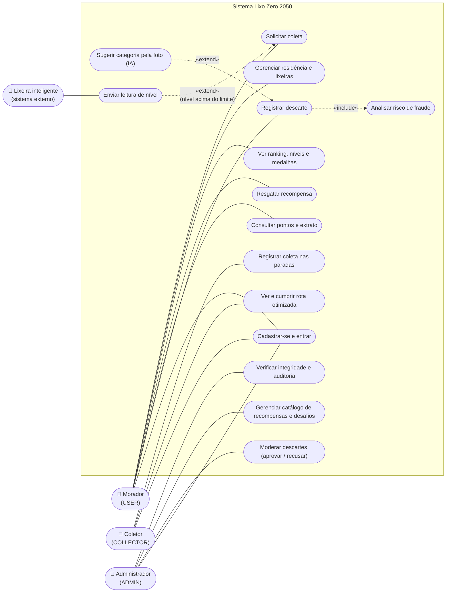
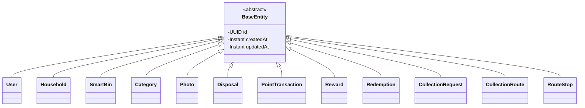
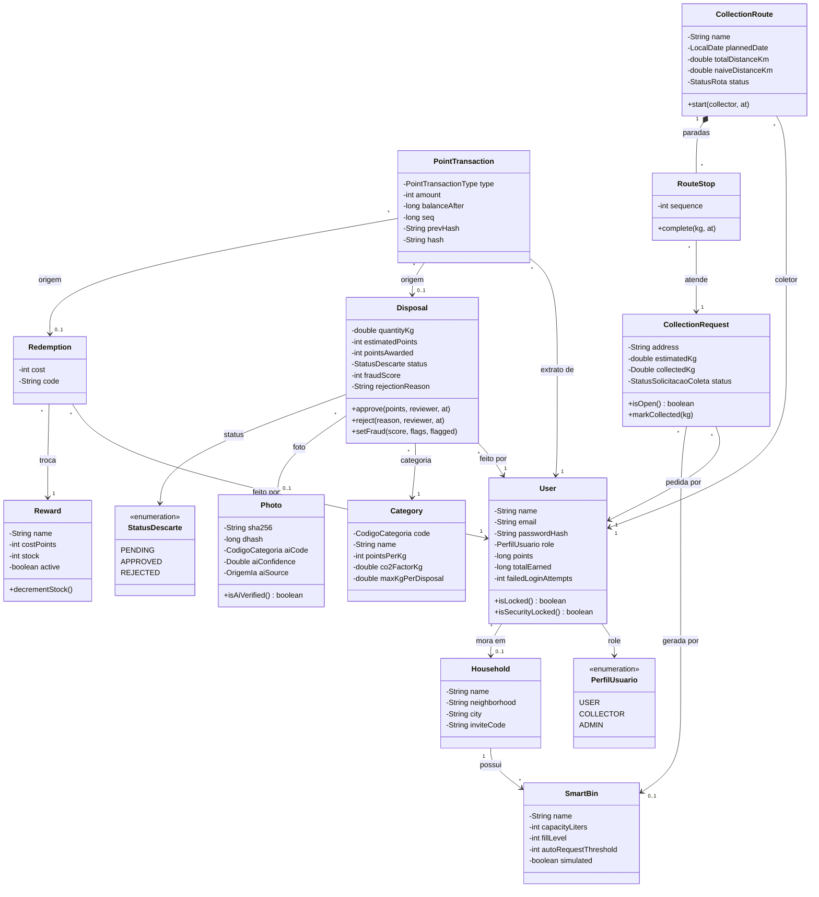
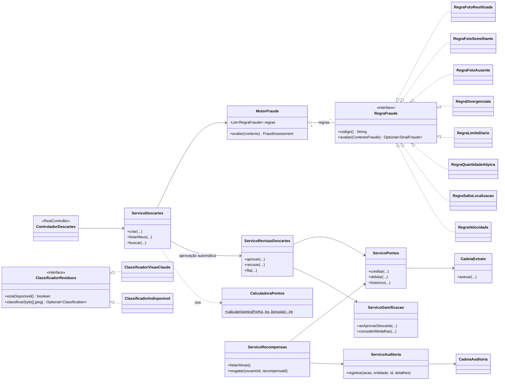
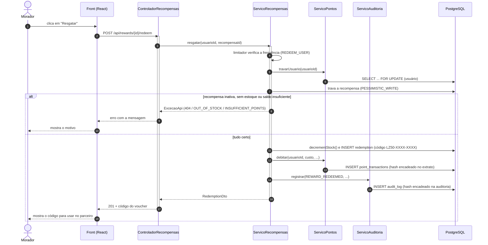

# UML do Lixo Zero 2050 — guia de estudo do grupo

Este arquivo junta, num lugar só, o que todo integrante precisa saber explicar sobre **UML** no nosso projeto:
o que é UML, **diagrama de casos de uso**, **diagrama de classes** e **diagrama de sequência**.
No final tem um resumo dos outros diagramas que já estão nos documentos (atividades, estados e DER) e
perguntas que a banca pode fazer.

Todos os nomes de classes e métodos citados aqui existem no código (`backend/src/main/java/br/com/ecotechzero/lixozero`).
As imagens prontas (PNG/SVG) ficam em `docs/diagramas/` com o mesmo nome indicado em cada diagrama.

---

## 1. O que é UML

**UML (Unified Modeling Language)** é uma linguagem *visual* padronizada para descrever um sistema de software.
Não é linguagem de programação: é um jeito comum de desenhar o sistema para que qualquer pessoa da equipe
(ou de fora) entenda a mesma coisa olhando o desenho.

A UML tem dois grandes grupos de diagramas:

| Grupo | Mostra | Exemplos no nosso projeto |
|---|---|---|
| **Estruturais** | *como o sistema é* (partes e ligações) | Diagrama de classes, DER (modelo de dados) |
| **Comportamentais** | *como o sistema age* (o que acontece e em que ordem) | Casos de uso, sequência, atividades (fluxogramas), estados |

Resumo para falar na apresentação:

- **Casos de uso** → *quem* usa o sistema e *o que* cada um pode fazer.
- **Classes** → *do que* o sistema é feito (classes, atributos, métodos e relações).
- **Sequência** → *em que ordem* as partes conversam para realizar uma ação.

---

## 2. Diagrama de casos de uso

### Para que serve

Mostra os **atores** (quem interage com o sistema) e os **casos de uso** (as funcionalidades que cada ator usa).
É o diagrama mais "alto nível": não fala de código, fala do que o usuário consegue fazer.

Elementos:

- **Ator** — papel de quem usa o sistema (não é uma pessoa específica). No nosso sistema os papéis vêm do enum
  `PerfilUsuario`: `USER` (morador), `COLLECTOR` (coletor) e `ADMIN` (administrador).
  A **lixeira inteligente** também é um ator, porque é um sistema externo que envia leituras.
- **Caso de uso** — uma ação completa com valor para o ator (ex.: "Registrar descarte").
- **Fronteira do sistema** — o retângulo que separa o que está dentro do sistema do que está fora.
- **«include»** — o caso de uso *sempre* usa o outro (registrar descarte sempre passa pela análise antifraude).
- **«extend»** — o caso de uso *às vezes* acrescenta o outro (a IA só sugere a categoria se o morador enviar foto).

<!-- diagrama: uml-casos-de-uso -->

> Observação: o Mermaid (ferramenta que usamos para gerar as imagens) não tem um tipo próprio de "casos de uso",
> então desenhamos com bonecos/elipses e setas tracejadas, seguindo a notação da UML.

### Como explicar

"O sistema tem três tipos de usuário. O **morador** registra o descarte, ganha pontos e troca por recompensas.
O **coletor** recebe uma rota otimizada e marca as coletas. O **administrador** modera os descartes que o antifraude
segurou, cuida do catálogo e confere a integridade dos dados. Além disso, a **lixeira inteligente** é um ator
externo: quando o nível passa do limite, ela pede uma coleta sozinha (por isso é um «extend»)."

---

## 3. Diagrama de classes

### Para que serve

Mostra as **classes** do sistema com seus **atributos** e **métodos**, e como elas se **relacionam**.
É o diagrama que mais se aproxima do código.

Notação usada:

| Símbolo | Significado | Exemplo no projeto |
|---|---|---|
| `+` / `-` | público / privado | `-points` (atributo privado), `+approve()` (método público) |
| `<\|--` (seta com triângulo vazado) | **herança** (*é um*) | `User` herda de `BaseEntity` |
| `<\|..` (tracejada com triângulo) | **realização** de interface (*implementa*) | `RegraFotoReutilizada` implementa `RegraFraude` |
| `-->` | **associação** (uma classe conhece a outra) | `Disposal` aponta para `User` |
| `*--` (losango cheio) | **composição** (a parte não vive sem o todo) | `CollectionRoute` é dona das `RouteStop` |
| `1`, `0..1`, `*` | **multiplicidade** | um `User` tem vários (`*`) `Disposal` |
| `«abstract»`, `«interface»`, `«enum»` | estereótipos | `BaseEntity`, `RegraFraude`, `StatusDescarte` |

### 3.1 Classes de domínio (o "coração" do sistema)

São as entidades JPA (cada uma vira uma tabela no PostgreSQL/Supabase). Os nomes delas ficaram em inglês porque
estão ligados às tabelas e às migrações do banco; as classes de serviço ficaram em português.
O diagrama mostra os atributos e métodos principais (não todos, para caber).

Primeiro, a **herança**: todas as entidades estendem a classe abstrata `BaseEntity`.

<!-- diagrama: uml-classes-heranca -->

Depois, as **associações** entre elas (para o desenho ficar legível, as setas de herança não são repetidas aqui):

<!-- diagrama: uml-classes-dominio -->

> Todas as entidades acima herdam `id`, `createdAt` e `updatedAt` de `BaseEntity`. A lista completa de entidades
> e colunas está no `MODELAGEM_DE_DADOS.md`.

### 3.2 Classes de serviço e interfaces (onde ficam as regras)

Aqui aparece bem a **orientação a objetos**: interfaces com várias implementações (polimorfismo) e serviços que
dependem de outros serviços (associação/injeção de dependência).

<!-- diagrama: uml-classes-servicos -->

### Como explicar

- **Herança:** todas as entidades herdam de `BaseEntity` (classe abstrata), que já traz `id`, `createdAt` e
  `updatedAt`. Assim não repetimos esses campos em cada classe.
- **Encapsulamento:** os atributos são privados. Por exemplo, ninguém muda o status de um `Disposal` direto;
  é preciso chamar `approve(...)` ou `reject(...)`, que validam e preenchem quem revisou e quando.
- **Interface e polimorfismo:** o `MotorFraude` recebe uma lista de `RegraFraude` e chama `avaliar(...)` em cada uma,
  sem saber qual regra é. Para criar uma regra nova basta escrever outra classe que implementa a interface —
  o motor não muda. O mesmo vale para `ClassificadorResiduos`: se a IA estiver configurada usa
  `ClassificadorVisaoClaude`, senão entra o `ClassificadorIndisponivel`.
- **Composição:** uma `CollectionRoute` é dona das suas `RouteStop`; se a rota não existe, as paradas também não.
- **Agregação (losango vazio):** o `MotorFraude` usa as regras, mas elas existem por conta própria (são componentes
  do Spring).
- **Enum:** `PerfilUsuario` e `StatusDescarte` limitam os valores possíveis (não dá para ter um status "inventado").

---

## 4. Diagrama de sequência

### Para que serve

Mostra **a troca de mensagens entre os objetos ao longo do tempo** para realizar *um* caso de uso.
Lê-se de cima para baixo.

Elementos:

- **Participantes / linhas de vida** — as caixas no topo com a linha tracejada para baixo.
- **Mensagem síncrona** (`->>`, seta cheia) — uma chamada que espera a resposta.
- **Retorno** (`-->>`, seta tracejada) — a resposta voltando.
- **Ativação** — a barrinha na linha de vida mostrando que o participante está trabalhando.
- **Fragmentos** — `alt` (se/senão), `opt` (opcional), `loop` (repetição).

### 4.1 Resgatar recompensa

Caso de uso "Resgatar recompensa" (rota `POST /api/rewards/{id}/redeem`), seguindo o método
`ServicoRecompensas.resgatar(...)`.

<!-- diagrama: uml-seq-resgate -->

### Como explicar

"Quando o morador resgata, o servidor primeiro **trava** o usuário e a recompensa no banco. Isso evita que dois
cliques ao mesmo tempo gastem o mesmo saldo ou a última unidade do estoque. Depois confere estoque e saldo; se
faltar algo, devolve o erro (é o fragmento `alt`). Se estiver tudo certo, baixa o estoque, gera o código do voucher,
debita os pontos no extrato e registra na auditoria — e esses dois registros são encadeados por hash, então não
dá para apagar ou alterar depois sem ser percebido."

### 4.2 Outros diagramas de sequência do projeto

Já estão no `FLUXOGRAMA.md`, seção 10, e também em imagem:

| Diagrama | Arquivo da imagem | O que mostra |
|---|---|---|
| Login e renovação da sessão | `docs/diagramas/seq-login-refresh.png` | CSRF, login com JWT em cookie, renovação com rotação do token e detecção de reuso |
| Envio de um descarte | `docs/diagramas/seq-descarte.png` | upload da foto, IA opcional, `MotorFraude` somando o risco, aprovação automática ou fila do admin |

---

## 5. Os outros diagramas do projeto (resumo)

Caso a banca pergunte por outro diagrama, eles já existem nos documentos:

| Diagrama | Tipo | Onde está | Para que serve |
|---|---|---|---|
| **Diagrama de atividades** (fluxogramas) | UML comportamental | `FLUXOGRAMA.md`, seções 1 a 9 | passo a passo de cada fluxo, com decisões (losangos) |
| **Diagrama de estados** | UML comportamental | `FLUXOGRAMA.md`, seção 11 | ciclo de vida do descarte, da solicitação de coleta e da rota |
| **DER / modelo entidade-relacionamento** | modelagem de dados (não é UML) | `MODELAGEM_DE_DADOS.md` | tabelas do banco, chaves e cardinalidades |
| **Diagrama de arquitetura** | visão geral (componentes) | `ARQUITETURA.md` | front, back, banco e serviços externos |

Diferença que costuma cair em pergunta:

- **Classes x DER:** o diagrama de classes mostra objetos com **métodos** e herança/interfaces; o DER mostra só
  **tabelas e colunas** do banco. Uma classe (`User`) vira uma tabela (`users`), mas classes de serviço
  (`ServicoPontos`) não viram tabela nenhuma.
- **Sequência x atividades:** a sequência mostra **quem conversa com quem** (participantes e mensagens); a atividade
  mostra **o fluxo de passos e decisões**, sem se preocupar com qual objeto executa.
- **Casos de uso x sequência:** o caso de uso diz **o que** o ator faz; a sequência detalha **como** um caso de uso
  acontece por dentro.

---

## 6. Perguntas que a banca pode fazer

1. **O que é UML?** — Linguagem visual padrão para modelar sistemas; tem diagramas estruturais e comportamentais.
2. **Quem são os atores do sistema?** — Morador, coletor, administrador (enum `PerfilUsuario`) e a lixeira inteligente.
3. **Qual a diferença entre «include» e «extend»?** — *Include* sempre acontece (descarte → antifraude);
   *extend* acontece só às vezes (IA só com foto; pedido automático só se a lixeira encher).
4. **Onde tem herança no projeto?** — Todas as entidades herdam de `BaseEntity`.
5. **Onde tem interface/polimorfismo?** — `RegraFraude` (8 regras), `ClassificadorResiduos` (2 implementações) e
   `RegraMedalha` (regra de cada medalha da gamificação).
6. **O que é composição?** — Relação "parte-todo" forte: as `RouteStop` só existem dentro de uma `CollectionRoute`.
7. **O que significa a multiplicidade `1` para `*`?** — Um usuário pode ter vários descartes; cada descarte é de um usuário só.
8. **Para que serve o fragmento `alt` no diagrama de sequência?** — Representa um "se/senão": no resgate, ou dá erro
   (sem saldo/estoque) ou o resgate é concluído.
9. **Por que travar o usuário no resgate?** — Para dois pedidos simultâneos não gastarem o mesmo saldo.
10. **Como vocês geraram os diagramas?** — Escritos em Mermaid dentro dos `.md` e convertidos para PNG/SVG pelo
    script `docs/diagramas/gerar-diagramas.mjs`.
